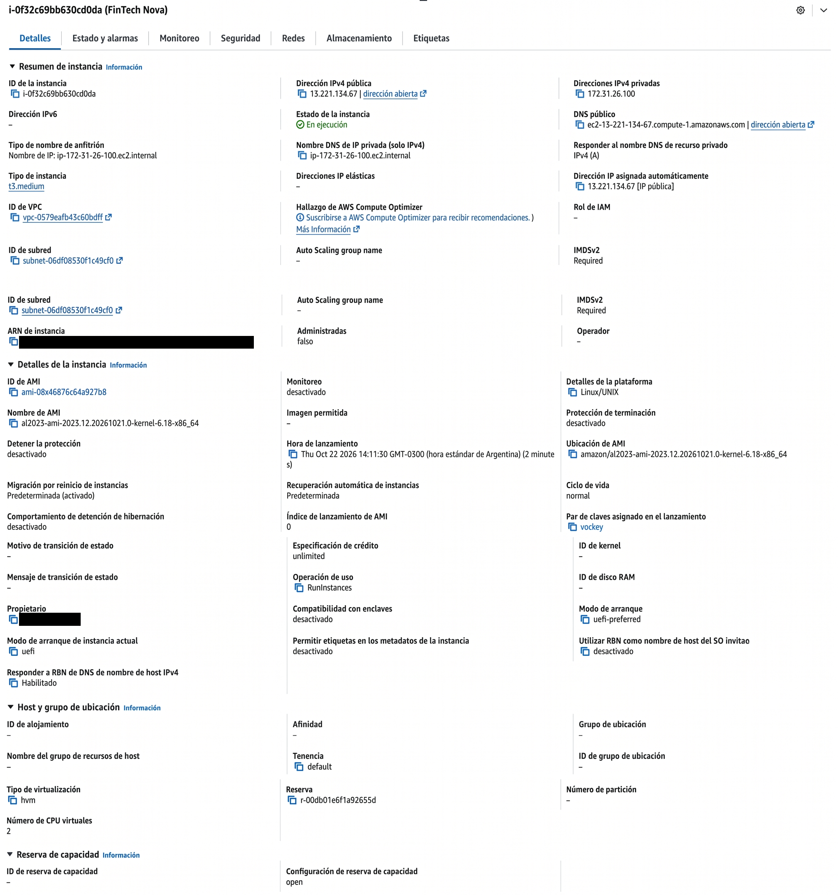
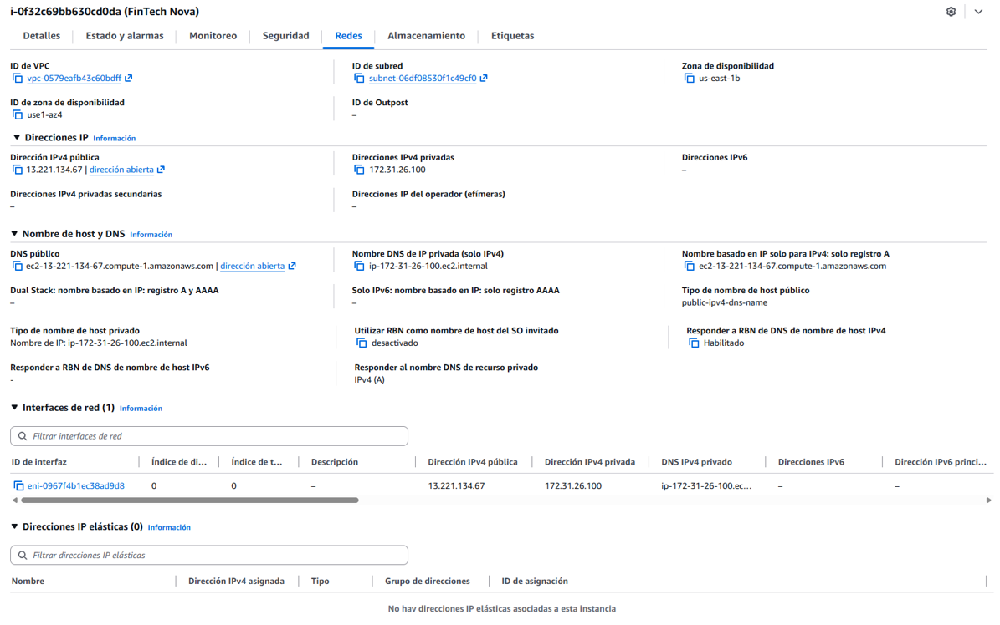
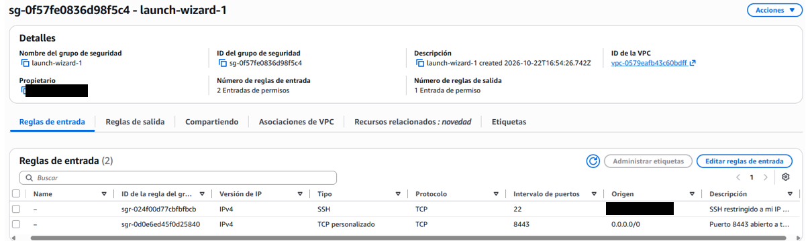
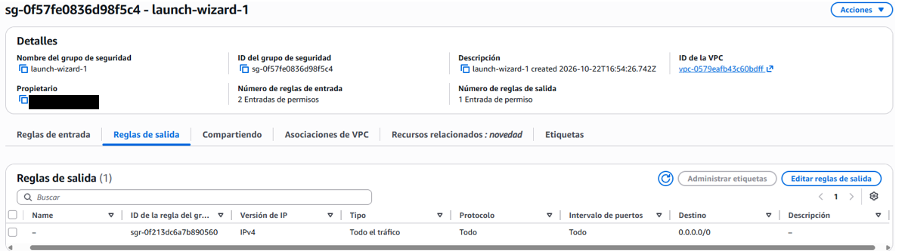
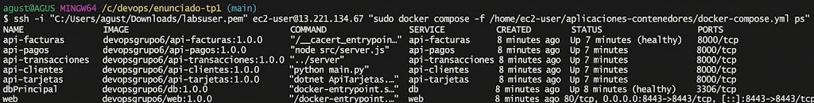
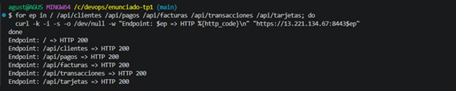

# ☁️ Evidencia de Configuración y Despliegue en AWS EC2

Este documento registra la configuración de infraestructura, red, Security Group y aprovisionamiento de la instancia **Amazon EC2** utilizada en el entorno **AWS Academy Learner Lab** para el despliegue de la plataforma **FinTech Nova**.

---

## 1. Especificaciones de la Instancia EC2

Los datos corresponden a la sesión de despliegue y validación del stack completo en **AWS Academy Learner Lab (`us-east-1`)**:

| Parámetro | Valor Configurado |
|---|---|
| **Proveedor / Entorno** | AWS Academy Learner Lab (Región `us-east-1` - N. Virginia) |
| **Nombre / Rol de la Instancia** | FinTech Nova |
| **ID de la Instancia** | `i-0f32c69bb630cd0da` |
| **Dirección IPv4 Pública** | `13.221.134.67` |
| **DNS de IPv4 Pública** | `ec2-13-221-134-67.compute-1.amazonaws.com` |
| **Sistema Operativo / AMI** | **Amazon Linux 2023** (`al2023-ami` — Kernel `6.18`, arquitectura `x86_64`) |
| **Tipo de Instancia** | **`t3.medium`** (2 vCPUs, 4 GiB de memoria RAM) |
| **Par de claves** | **`vockey`** |
| **Almacenamiento (EBS)** | 8 GiB `gp3` (SSD de uso general) |
| **Par de Claves SSH (Key Pair)** | `labsuser.pem` (RSA) |

> **Justificación del dimensionamiento (`t3.medium`):** Con 7 contenedores en ejecución simultánea, la suma de los topes de memoria asignados en `docker-compose.yml` alcanza los **2048 MB (2 GiB)**. La instancia `t3.medium` (4 GiB de RAM y 2 vCPUs) garantiza que el sistema operativo host y el demonio de Docker operen con holgura.

### Evidencia del Resumen de la Instancia en AWS Console


---

## 2. Red Virtual (VPC y Subred)

La instancia fue desplegada dentro de la VPC predeterminada del entorno con asignación automática de IP pública habilitada para permitir el acceso HTTPS via `web`:

| Recurso de Red | Identificador / Configuración |
|---|---|
| **VPC ID** | `vpc-0579eafb43c60bdff` |
| **Subnet ID (Subred)** | `subnet-06df08530f1c49cf0` |
| **Zona de Disponibilidad (AZ)** | `us-east-1` (Subred pública con salida a Internet vía Internet Gateway) |
| **Asignación automática de IP pública** | Habilitada |

### Evidencia de Configuración de Red en AWS Console


---

## 3. Grupo de Seguridad (Security Group / Firewall)

Se creó y asoció el grupo de seguridad **`launch-wizard-1`** aplicando el principio de **mínima exposición**: únicamente se permite el acceso administrativo por SSH desde la IP pública del operador y el tráfico HTTPS en el puerto `8443` hacia el contenedor `web`. **El puerto `80` (HTTP sin cifrar) y los puertos internos de las APIs (`8080`) y de la base de datos (`3306`) se encuentran completamente cerrados**.

### A. Reglas de Entrada (*Inbound Rules*)

| Tipo | Protocolo | Rango de Puertos | Origen (*Source*) | Propósito / Justificación |
|---|---|---|---|---|
| **SSH** | `TCP` | `22` | `<MI_IP>/32` (Mi IP) | Administración remota por SSH y transferencia de `.env` por `scp` restringida exclusivamente a la IP del administrador. |
| **TCP personalizado (HTTPS)** | `TCP` | `8443` | `0.0.0.0/0` (Cualquier lugar IPv4) | Único punto de entrada público hacia el frontend y proxy inverso NGINX (`web`) con cifrado TLS. |

### B. Reglas de Salida (*Outbound Rules*)

| Tipo | Protocolo | Rango de Puertos | Destino (*Destination*) | Propósito / Justificación |
|---|---|---|---|---|
| **Todo el tráfico (*All traffic*)** | Todos (`All`) | Todos (`All`) | `0.0.0.0/0` | Permite a la instancia descargar paquetes de `dnf`, hacer `docker compose pull` desde Docker Hub y que `api-pagos` (`open.er-api.com`) y `api-transacciones` (`ipapi.co`) consulten sus APIs públicas externas por HTTPS (`443`). |

### Evidencia del Security Group en AWS Console




---

## 4. Conexión SSH y Configuración Previa de la Instancia

### A. Cómo nos conectamos a la instancia
La conexión se realiza mediante **OpenSSH** utilizando el usuario predeterminado de Amazon Linux 2023 (**`ec2-user`**) y la clave privada RSA descargada al aprovisionar la instancia, asegurando previamente permisos de solo lectura para el propietario (`chmod 400`):

```bash
chmod 400 "<RUTA_CLAVE_PEM>"
ssh -i "<RUTA_CLAVE_PEM>" ec2-user@<EC2_IP>
```

### B. Qué se configuró en la instancia antes de levantar los contenedores
Todo el aprovisionamiento previo de la instancia virgen está automatizado de principio a fin dentro del script [`deploy.sh`](./deploy.sh), el cual ejecuta los siguientes pasos sin intervención manual:

1. **Actualización del sistema e instalación de Docker Engine y OpenSSL:**
   En Amazon Linux 2023 se utiliza el gestor de paquetes `dnf` (omitiendo `curl` para evitar conflictos con `curl-minimal` preinstalado en la AMI), se habilita e inicia el servicio `docker` en `systemd` y se agrega el usuario `ec2-user` al grupo `docker`:
   ```bash
   sudo dnf update -y
   sudo dnf install -y docker openssl
   sudo systemctl enable --now docker
   sudo usermod -aG docker ec2-user
   ```
2. **Instalación del plugin oficial de Docker Compose v2:**
   Dado que el paquete `docker` de Amazon Linux 2023 no incluye el subcomando `docker compose` por defecto, el script descarga el binario oficial para la arquitectura de la instancia (`uname -m`) en el directorio de plugins de RedHat/AL2023 (`/usr/libexec/docker/cli-plugins/docker-compose`):
   ```bash
   sudo mkdir -p /usr/libexec/docker/cli-plugins
   sudo curl -SL \
       "https://github.com/docker/compose/releases/latest/download/docker-compose-linux-$(uname -m)" \
       -o /usr/libexec/docker/cli-plugins/docker-compose
   sudo chmod +x /usr/libexec/docker/cli-plugins/docker-compose
   ```
3. **Creación de la estructura de directorios de trabajo:**
   Se crean en `/home/ec2-user/aplicaciones-contenedores` el directorio `certs/` y las subcarpetas de los 6 servicios que utilizan variables de entorno (`db`, `api-clientes`, `api-pagos`, `api-facturas`, `api-transacciones`, `api-tarjetas`).
4. **Transferencia segura de `docker-compose.yml` y archivos `.env` (`scp`):**
   Se copian el archivo `docker-compose.yml` y los 6 archivos `.env` locales mediante `scp` y se normalizan los saltos de línea a `LF` (`sed -i 's/\r$//' */.env docker-compose.yml`).
5. **Generación del certificado TLS autofirmado en *runtime*:**
   Se ejecuta `openssl req -x509` directamente dentro de la instancia EC2 para crear `certs/key.pem` y `certs/cert.pem` con permisos `644` (lectura para el usuario no-root `nginx` cuando se monta `./certs:/etc/nginx/certs:ro`).
6. **Descarga de imágenes e inicio del stack:**
   Como las 7 imágenes publicadas en las cuentas de Docker Hub del grupo son **públicas**, no se requiere almacenar credenciales de `docker login` en la EC2. El script ejecuta directamente:
   ```bash
   sudo docker compose pull
   sudo docker compose up -d
   sudo docker compose ps
   ```
7. **Verificación automática (*Smoke Tests*):**
   Desde la máquina local, [`deploy.sh`](./deploy.sh) realiza peticiones `curl -k` contra `https://<EC2_IP>:8443/` y los 5 endpoints `/api/*` verificando que todos respondan `HTTP 200`.

### Evidencia de Ejecución del Despliegue y Contenedores Activos





---

# Parte 2 — Despliegue automatizado con Terraform y GitLab CI/CD

En la Parte 2 la instancia ya no se crea a mano: la crea el pipeline con **Terraform** (carpeta [`infra/`](./infra/)) y la despliega por SSH. El sandbox de AWS Academy entrega en cada relanzamiento una instancia, IP, Security Group, llaves y credenciales nuevas; con Terraform, todo eso se vuelve a crear de forma idéntica en cada sesión.

## 5. Qué cambia respecto de la Parte 1

| Paso | Parte 1 (manual) | Parte 2 (pipeline) |
|---|---|---|
| Crear la EC2 y el Security Group | Consola de AWS | `infra-apply` (Terraform) |
| Llave SSH | Descargar `labsuser.pem` en cada sesión | Llave propia del deploy, fija en GitLab; Terraform sube la pública |
| Puerto 22 | Abierto a la IP del administrador | Abierto **solo a la IP del runner**, calculada en cada corrida |
| Identidad de la instancia | Se aceptaba en la primera conexión | Se lee del registro del sistema por la API de AWS antes de conectar |
| Imágenes | Docker Hub, públicas | Docker Hub, con token de solo lectura |
| Despliegue y verificación | `deploy.sh` desde una PC | Jobs `deploy` y `verify-deployment` |

## 6. Recursos que crea Terraform

| Recurso | Configuración |
|---|---|
| Security Group `fintech-nova-grupo6-sg` | Entrada: `22` solo desde la IP del runner (y, opcionalmente, la de un integrante con `TF_VAR_admin_cidr`); `8443` desde `0.0.0.0/0`. Sin reglas para `80` ni `3306`, que quedan cerrados. Salida libre. |
| Key pair `fintech-nova-grupo6-deploy` | Llave pública [`infra/deploy-key.pub`](./infra/deploy-key.pub). |
| Instancia `fintech-nova-grupo6` | `t3.medium`, Amazon Linux 2023 (`x86_64`), disco `gp3` de 8 GiB **cifrado**, **IMDSv2 obligatorio**, IP pública, VPC y subred por defecto. |

Todos los recursos llevan las etiquetas `Proyecto = fintech-nova-grupo6` y `Gestion = terraform`. Las variables tienen bloques `validation` que frenan valores inválidos antes de llamar a AWS (por ejemplo, un tipo de instancia distinto de `t3.medium` o `t3.large`, o abrir el SSH a `0.0.0.0/0`).

El **estado** de Terraform se guarda en GitLab (Operate → Terraform states) y no en AWS, porque el sandbox borra sus recursos al relanzarse. Si `infra-apply` se ejecuta dos veces en la misma sesión, no crea una instancia nueva: solo vuelve a desplegar.

## 7. Procedimiento al iniciar cada sesión del sandbox

1. En AWS Academy, iniciar el lab y esperar a que el indicador quede en verde.
2. Abrir **AWS Details → AWS CLI → Show** y copiar los tres valores.
3. En GitLab (Settings → CI/CD → Variables), actualizar `AWS_ACCESS_KEY_ID`, `AWS_SECRET_ACCESS_KEY` y `AWS_SESSION_TOKEN`.
4. En el último pipeline de `main` (Build → Pipelines), ejecutar ▶ en el job `infra-apply`. **No usar el botón de la etapa `infra`**: ejecuta también `infra-destroy` y borra la instancia apenas termina el despliegue ([ERRORES.md](./ERRORES.md), error 46).
5. `deploy` y `verify-deployment` corren solos. La URL de la aplicación queda en Operate → Environments → `production`.
6. Opcional: al terminar, ejecutar ▶ en `infra-destroy` para borrar la infraestructura antes de que venza la sesión.

Las credenciales de AWS no se pueden automatizar: AWS Academy no permite crear usuarios IAM ni proveedores de identidad (OIDC), y las credenciales del lab vencen al cerrarse la sesión.

## 8. Configuración inicial (una sola vez)

1. Generar el par de llaves del deploy fuera del repositorio y versionar solo la pública:
   ```bash
   ssh-keygen -t ed25519 -N "" -C "gitlab-ci-deploy-fintech-nova" -f ~/.ssh/fintech-nova-deploy
   cp ~/.ssh/fintech-nova-deploy.pub infra/deploy-key.pub
   ```
2. Cargar la llave **privada** en la variable `EC2_SSH_PRIVATE_KEY` (tipo File, protegida, entorno `production`).
3. Crear las tres variables `AWS_*` (enmascaradas, protegidas, entorno `production`) y, si hace falta, `TF_VAR_admin_cidr`.

La tabla completa de variables está en [`PIPELINE.md`](./PIPELINE.md#configuración-necesaria-en-gitlab).

## 9. Evidencia de la primera sesión (configuración manual)

Antes de automatizar la infraestructura, la primera instancia de la Parte 2 se creó a mano para validar el procedimiento que después se trasladó a Terraform. En esa sesión se comprobó:

- Que el pipeline prepara la instancia desde cero: la instancia recién creada no tenía Docker.
- Que las reglas de entrada del Security Group eran las previstas: `22` restringido, `8443` público, sin `80` ni `3306`.
- Que la clave `ssh-ed25519` publicada en el registro del sistema de la instancia coincidía con la que la instancia presenta por la red (`ssh-keyscan`). Es el mismo control que `infra-apply` ahora realiza automáticamente por la API de AWS.

La evidencia de la última sesión, con el pipeline completo, está en el [README §8](./README.md#-8-evidencia).

## 10. Última sesión con el pipeline completo

Sesión del sandbox del 19 y 20/11/2026. Pipeline **#17424** de `main` (commit `072d47d6`, merge de la parte de validación y hardening). Toda la infraestructura la creó `infra-apply` con Terraform; no se tocó la consola de AWS.

| Dato | Valor |
|---|---|
| Instancia | `i-088fc20bf1cd0f322`, `t3.medium`, Amazon Linux 2023 |
| IP pública | `3.84.215.156` |
| URL de la aplicación | `https://3.84.215.156:8443` |
| Security Group | `fintech-nova-grupo6-sg`. Entrada: `22` solo desde la IP de salida del runner (`200.10.191.20/32`) y `8443` desde `0.0.0.0/0`. Sin reglas para `80` ni `3306`. |
| Llave SSH | `fintech-nova-grupo6-deploy` (ed25519, llave propia del deploy) |
| Disco | gp3 de 8 GiB, cifrado |
| Metadatos de la instancia | IMDSv2 obligatorio |
| Resultado | `deploy` levantó los 7 contenedores con el compose endurecido y `verify-deployment` obtuvo HTTP 200 en la web y las 5 APIs, con el puerto 80 cerrado. |

En esa misma sesión, una ejecución anterior del mismo pipeline (instancia `i-0f15d81e9da241c92`, IP `3.87.120.0`) también completó `deploy` y `verify`, y después se destruyó con `infra-destroy` ([ERRORES.md](./ERRORES.md), error 46). La segunda ejecución de `infra-apply` volvió a crear los 6 recursos desde cero, lo que confirma que la infraestructura se puede recrear sin pasos manuales.
