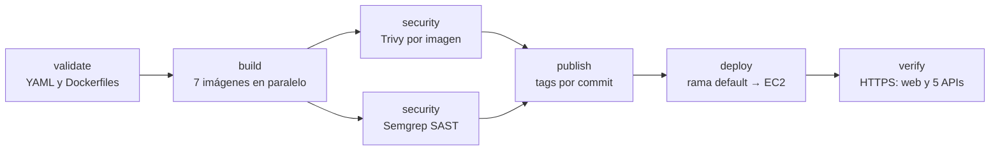

# Punto 1 — Pipeline de GitLab CI/CD

El pipeline automatiza la validación, construcción, análisis, publicación y despliegue del stack
de FinTech Nova. Está definido en [`.gitlab-ci.yml`](./.gitlab-ci.yml) y utiliza el
[`docker-compose.yml`](./aplicaciones-contenedores/docker-compose.yml) actualizado para obtener
las imágenes del Container Registry del proyecto.

## Flujo

- **validate:** Yamllint revisa el pipeline y Compose; Hadolint revisa los Dockerfiles.
- **build:** construye las siete imágenes (`db`, `api-clientes`, `api-pagos`, `api-facturas`,
  `api-transacciones`, `api-tarjetas` y `web`) en paralelo. Las sube al registry con una etiqueta
  candidata asociada al commit.
- **security:** Semgrep analiza el código fuente y Trivy escanea las imágenes candidatas en
  paralelo. Los reportes JSON de ambos controles quedan disponibles como artifacts por una semana.
- **publish:** si los controles anteriores pasan, etiqueta y publica las imágenes con el SHA
  completo del commit. Así, cada despliegue queda vinculado a una revisión concreta y no depende
  de `latest`.
- **deploy:** solo se ejecuta en la rama por defecto. Se conecta por SSH a EC2, instala Docker y
  Compose si hace falta, copia el Compose y los archivos de entorno, inicia sesión al registry con
  credenciales de solo lectura y levanta los servicios.
- **verify:** prueba por HTTPS (`8443`) la web y los endpoints de las cinco APIs. El job falla si
  cualquiera no devuelve HTTP 200.

El escaneo de Trivy corta el flujo ante vulnerabilidades **HIGH** o **CRITICAL**. Semgrep también
falla ante los hallazgos que reporta con la configuración automática seleccionada. Un fallo en
validación o seguridad impide que se publiquen las etiquetas finales y que avance el despliegue.

## Configuración necesaria en GitLab

El despliegue requiere un runner con soporte para Docker-in-Docker y conectividad SSH hacia la
instancia EC2. Configurar las siguientes variables de CI/CD como **protegidas** y, para valores
secretos compatibles, **enmascaradas**. Los secretos y archivos `.env` no se guardan en el
repositorio:

| Variable | Tipo / contenido |
|---|---|
| `EC2_HOST` | Dirección IP o hostname actual de la instancia del sandbox. |
| `EC2_SSH_PRIVATE_KEY` | Variable de tipo **File** con la clave SSH privada de EC2. |
| `EC2_KNOWN_HOSTS` | Variable de tipo **File** con la clave pública verificada del host. |
| `REGISTRY_DEPLOY_USER` | Usuario de deploy token con permiso de solo lectura del registry. |
| `REGISTRY_DEPLOY_PASSWORD` | Contraseña/token de ese usuario; enmascarada. |
| `DB_ENV_FILE` | Variable de tipo **File** con la configuración de MariaDB. |
| `API_CLIENTES_ENV_FILE` | Variable de tipo **File** con el entorno de `api-clientes`. |
| `API_PAGOS_ENV_FILE` | Variable de tipo **File** con el entorno de `api-pagos`. |
| `API_FACTURAS_ENV_FILE` | Variable de tipo **File** con el entorno de `api-facturas`. |
| `API_TRANSACCIONES_ENV_FILE` | Variable de tipo **File** con el entorno de `api-transacciones`. |
| `API_TARJETAS_ENV_FILE` | Variable de tipo **File** con el entorno de `api-tarjetas`. |

GitLab provee `CI_REGISTRY`, `CI_REGISTRY_IMAGE`, `CI_REGISTRY_USER` y `CI_REGISTRY_PASSWORD`
para la publicación desde el pipeline. Como el sandbox renueva sus recursos y credenciales al
iniciar una sesión, hay que actualizar las variables de EC2 y SSH antes de ejecutar el despliegue.

## Estado

La estructura YAML, la correspondencia de servicios entre Compose y las matrices del pipeline, y
la configuración local de Compose fueron validadas. El pipeline completo todavía debe ejecutarse
en GitLab con el runner, las variables y una instancia activa del sandbox; las imágenes y la
verificación de despliegue dependen de esos recursos.
