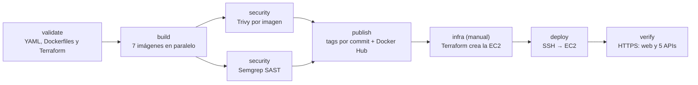

# Punto 1 — Pipeline de GitLab CI/CD

El pipeline automatiza la validación, construcción, análisis, publicación y despliegue del stack
de FinTech Nova. Está definido en [`.gitlab-ci.yml`](./.gitlab-ci.yml) y utiliza el
[`docker-compose.yml`](./aplicaciones-contenedores/docker-compose.yml) actualizado para obtener
las imágenes del Container Registry del proyecto.

## Flujo

- **validate:** Yamllint revisa el pipeline y Compose; Hadolint revisa los Dockerfiles;
  `terraform-validate` revisa el formato y la sintaxis de la infraestructura (`infra/`) sin
  credenciales de AWS.
- **build:** construye las siete imágenes (`db`, `api-clientes`, `api-pagos`, `api-facturas`,
  `api-transacciones`, `api-tarjetas` y `web`) en paralelo. Las sube al registry con una etiqueta
  candidata asociada al commit.
- **security:** Semgrep analiza el código fuente y Trivy escanea las imágenes candidatas en
  paralelo. Los reportes JSON de ambos controles quedan disponibles como artifacts por una semana.
  La imagen la descarga el Docker del runner, que confía en el certificado del registry del labsys,
  y Trivy la analiza desde ahí (`--image-src docker`). Al terminar, el job cierra la sesión del
  registry y borra la imagen para no ocupar el disco del runner.
- **publish:** si los controles anteriores pasan, etiqueta y publica las imágenes con el SHA
  completo del commit. Así, cada despliegue queda vinculado a una revisión concreta y no depende
  de `latest`. En la rama por defecto, además, sube las imágenes aprobadas a Docker Hub
  (`devopsgrupo6`): la EC2 no puede acceder al registry del labsys, que solo existe dentro de la
  red de la facultad. Las imágenes candidatas nunca salen del registry interno.
- **infra:** solo en la rama por defecto y **manual** (`infra-apply`): el pipeline corre hasta
  `publish` y deja el despliegue esperando, porque el sandbox de AWS está apagado la mayor parte
  del tiempo. Mientras no se ejecuta, el pipeline queda en verde. Al ejecutarlo, Terraform crea en
  el sandbox el Security Group, la llave SSH y la instancia EC2 (ver [`AWS_EC2.md`](./AWS_EC2.md)).
  Después lee la clave pública del host desde el registro del sistema de la instancia, por la
  API de AWS, y se la pasa a `deploy` junto con la IP. Si la infraestructura ya existe en esa
  sesión, no crea nada nuevo. `infra-destroy` (manual y opcional) borra todo.
- **deploy:** corre automáticamente después de `infra-apply`. Se conecta por SSH a EC2, instala Docker y
  el plugin de Compose si hace falta (en versión fija, `v5.5.1`, verificando su checksum SHA-256
  antes de instalarlo), copia el Compose y los archivos de entorno (quitando los saltos de línea
  CRLF de Windows), inicia sesión en Docker Hub
  con un token de solo lectura, descarga las imágenes y levanta los servicios. El cierre de sesión
  se ejecuta siempre, aunque el despliegue falle, para no dejar la credencial guardada en la EC2.
- **verify:** prueba por HTTPS (`8443`) la web y los endpoints de las cinco APIs. El job falla si
  cualquiera no devuelve HTTP 200, o si el puerto `80` responde (debe estar cerrado). El entorno
  `production` muestra en GitLab (Operate → Environments) el enlace a la aplicación desplegada.
  Si `deploy` falla, `verify` no corre y el pipeline queda en rojo.
- **runners:** todos los jobs usan el mismo tag de runner (`runner-without-dind`).

El escaneo de Trivy corta el flujo ante vulnerabilidades **HIGH** o **CRITICAL**. Semgrep también
falla ante los hallazgos que reporta con la configuración automática seleccionada. Un fallo en
validación o seguridad impide que se publiquen las etiquetas finales y que avance el despliegue.

## Configuración necesaria en GitLab

El despliegue requiere un runner con soporte para Docker-in-Docker y conectividad SSH hacia la
instancia EC2. Configurar las siguientes variables de CI/CD como **protegidas** y, para valores
secretos compatibles, **enmascaradas**. Los secretos y archivos `.env` no se guardan en el
repositorio:

| Variable | Tipo / contenido |
|---|---|
| `AWS_ACCESS_KEY_ID` | Credencial del sandbox (AWS Details → AWS CLI). **Se actualiza en cada sesión.** Enmascarada, protegida y limitada al entorno `production`. |
| `AWS_SECRET_ACCESS_KEY` | Ídem. |
| `AWS_SESSION_TOKEN` | Ídem. |
| `TF_VAR_admin_cidr` | Opcional. IP `/32` de un integrante que necesite entrar por SSH a la instancia. |
| `EC2_SSH_PRIVATE_KEY` | Variable de tipo **File** con la llave SSH privada del deploy. Su llave pública es [`infra/deploy-key.pub`](./infra/deploy-key.pub). |
| `DOCKERHUB_USER` | Usuario de la cuenta de Docker Hub del grupo. Visible y protegida. |
| `DOCKERHUB_PUSH_TOKEN` | Token de acceso de Docker Hub con permiso **Read & Write** y vencimiento. Solo lo usa `publish`. Enmascarado, oculto y protegido. |
| `DOCKERHUB_PULL_TOKEN` | Token de acceso de Docker Hub con permiso **Read-only** y vencimiento. Limitado al entorno `production`, así que solo lo recibe `deploy`. Enmascarado, oculto y protegido. |
| `DB_ENV_FILE` | Variable de tipo **File** con la configuración de MariaDB. |
| `API_CLIENTES_ENV_FILE` | Variable de tipo **File** con el entorno de `api-clientes`. |
| `API_PAGOS_ENV_FILE` | Variable de tipo **File** con el entorno de `api-pagos`. |
| `API_FACTURAS_ENV_FILE` | Variable de tipo **File** con el entorno de `api-facturas`. |
| `API_TRANSACCIONES_ENV_FILE` | Variable de tipo **File** con el entorno de `api-transacciones`. |
| `API_TARJETAS_ENV_FILE` | Variable de tipo **File** con el entorno de `api-tarjetas`. |

GitLab provee `CI_REGISTRY`, `CI_PROJECT_PATH`, `CI_REGISTRY_USER` y `CI_REGISTRY_PASSWORD`.
El pipeline forma `REGISTRY_IMAGE` con `CI_REGISTRY` y `CI_PROJECT_PATH` para apuntar al
registry del proyecto, donde se guardan y escanean las imágenes candidatas. La cuenta de Docker
Hub (`DOCKERHUB_NAMESPACE`) está definida en el `.gitlab-ci.yml` porque no es un secreto. Los
tokens de Docker Hub son variables protegidas: solo existen en los pipelines de la rama por
defecto, por eso la publicación en Docker Hub se omite en las demás ramas.

El estado de Terraform se guarda en GitLab (Operate → Terraform states), no en AWS, porque el
sandbox borra sus recursos en cada relanzamiento. `infra-apply` se autentica contra ese estado con
el token del job (`CI_JOB_TOKEN`), así que no requiere otra credencial.

Al iniciar cada sesión del sandbox solo hay que actualizar las tres variables `AWS_*` y ejecutar
`infra-apply`. El procedimiento completo está en [`AWS_EC2.md`](./AWS_EC2.md).

## Estado

El pipeline de la rama por defecto se ejecutó completo, de `validate` a `verify` (pipeline
#17361), con una sesión activa del sandbox:

- `infra-apply` creó los 6 recursos con Terraform y obtuvo la clave del host por la API de AWS.
- `deploy` se conectó por SSH verificando esa clave, levantó los 7 contenedores con las imágenes
  de Docker Hub etiquetadas con el SHA del commit y cerró la sesión de Docker Hub.
- `verify-deployment` obtuvo HTTP 200 en la web y en las 5 APIs, y confirmó que el puerto 80 está
  cerrado.
- `infra-destroy` borró los 6 recursos al terminar.
