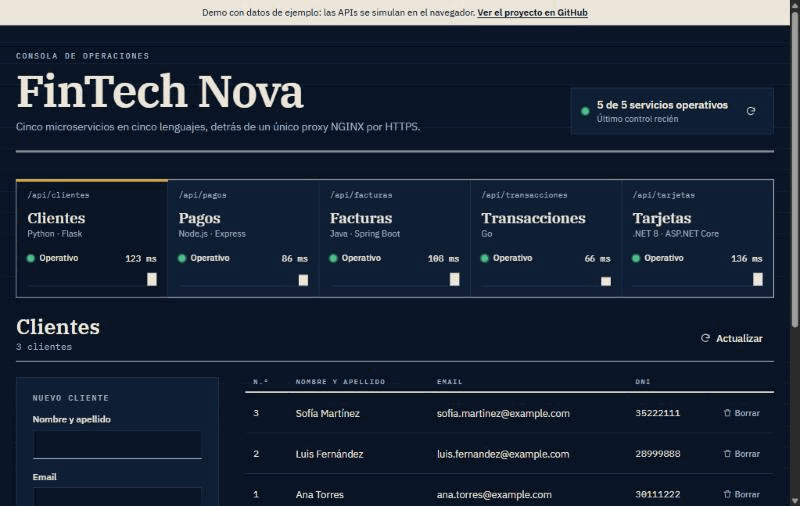
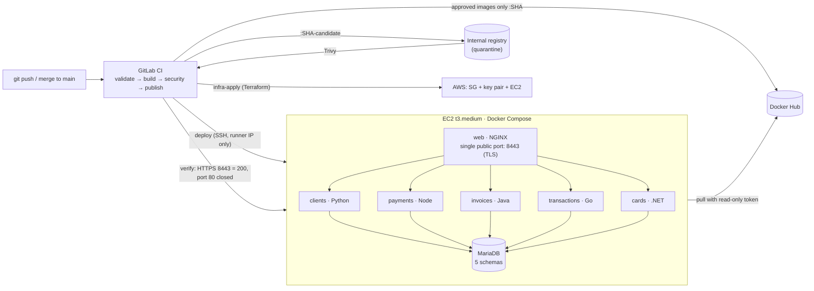

# FinTech Nova — Containerized microservices, from commit to AWS

[](https://github.com/agusgut0/fintech-nova/actions/workflows/ci.yml)
[](https://agusgut0.github.io/fintech-nova/)


🇦🇷 [Versión en español](./README.md)

A banking platform with **5 APIs written in 5 languages** (Python, Node.js, Java, Go and .NET), a MariaDB database and an NGINX reverse proxy. It is containerized, scanned on every commit and deployed to **AWS EC2** by a pipeline that provisions the infrastructure with **Terraform**, deploys the stack and verifies the result.

This was the capstone project of the *DevOps* course in the Information Systems Engineering degree at UTN FRC (Argentina, 2026), built by a 4-person team. **Grade: 10/10.**

> Detailed documentation (ADRs, runbooks, postmortems, security policy) is in Spanish. This page summarizes it.

[](https://agusgut0.github.io/fintech-nova/)

<sub>Screenshot with sample data. The UI is in Spanish. **[Try the live demo](https://agusgut0.github.io/fintech-nova/)**: the real console, with the APIs simulated in the browser.</sub>

---

## At a glance

| Problem | What we did | Measurable result |
|---|---|---|
| Images were built on a teammate's laptop and nobody scanned them. | Pipeline with parallel builds and a security gate (Trivy, Semgrep, Gitleaks, Hadolint). | **13 critical vulnerabilities** found and fixed on the first scan. |
| Scanning 7 images one after another was slow. | `parallel: matrix`, one job per image. | Scan stage went from about **48 min to 8.5 min**. |
| The EC2 instance and its Security Group were created by hand in every sandbox session. | Terraform inside the pipeline, with remote state in GitLab. | **6 resources** recreated from scratch in one click, with an encrypted disk and IMDSv2 required. |
| The Spring Boot API started slowly and the frontend showed empty tables. | Healthcheck, `depends_on: service_healthy` and JVM startup flags. | Startup went from **45.6 s to about 1 s**. |
| A green deploy job does not prove the app works. | A `verify-deployment` job over HTTPS. | Every deploy checks 6 endpoints for HTTP 200 **and** that port 80 is closed. |

## My role

I owned the **AWS deployment**: the Terraform infrastructure (EC2, Security Group, key pair), the `infra-apply`, `deploy` and `verify-deployment` jobs, and secret handling for the deploy. That includes File-type CI variables, a read-only registry token that expires, and an SSH `known_hosts` entry verified against the AWS API instead of trust-on-first-use. I also worked on containerizing the services and reviewed the whole pipeline, because in the oral exam any team member could be asked about any part of it.

## Architecture



- **One public port.** NGINX runs as a non-root user, terminates TLS on `8443` and routes `/api/<svc>` over an internal Docker network. No API or database publishes a port, and the pipeline enforces it.
- **The image that was scanned is the image that gets deployed.** Candidate images stay quarantined in an internal registry. Only those that pass Trivy are pushed to Docker Hub, and the digest is the same in both registries.
- **Traceability.** Every image is tagged with its commit SHA. `latest` is never used.
- **Hardened runtime.** All 7 containers run with `cap_drop: [ALL]`, `no-new-privileges`, a read-only filesystem, resource limits, log rotation and `restart: always`.
- **Graceful degradation.** If the external FX or geo-IP APIs fail, the app keeps working and only the enriched field is missing.

## Run it locally

Requirements: Docker with Compose v2, `openssl` and `curl`.

```bash
cd aplicaciones-contenedores
sh generar-env.sh   # creates the 6 .env files with random passwords (never committed)
mkdir -p certs && openssl req -x509 -nodes -days 365 -newkey rsa:2048 -keyout certs/key.pem -out certs/cert.pem -subj "/CN=localhost" && chmod 644 certs/*.pem
# Images published to Docker Hub by the last main pipeline (tag = commit SHA in the original GitLab repo)
IMAGE_TAG=a7aebcac8ae676d6e0d3264a48b48c02c42d3969 docker compose up -d --wait
```

Then open `https://localhost:8443`. The certificate is self-signed.

## Pipelines

| | GitLab CI (`.gitlab-ci.yml`) | GitHub Actions (`.github/workflows/ci.yml`) |
|---|---|---|
| Purpose | **The project's real pipeline**, including the AWS deploy | Mirror for this public repository |
| Validation | yamllint, Hadolint, ShellCheck, Compose policy checks, `terraform validate`, linters for 5 languages | Same, without the language linters |
| Security | Gitleaks (full history), Semgrep, Trivy fs and Trivy per image | Gitleaks, Semgrep and Trivy per image, with findings uploaded to the **Security** tab (SARIF) |
| Delivery | Publish → Terraform → SSH deploy → verify | `smoke-test`: the full stack started on the runner, with the same checks as `verify` |

**Security gate policy:** the pipeline fails on any leaked secret, on Semgrep `ERROR` findings, on a Dockerfile whose last `USER` is root, on Compose policy violations, and on **CRITICAL vulnerabilities that have a fix available**. Unfixable CVEs are accepted per image, with a written justification and a review date ([ADR-0004](./docs/adr/0004-politica-de-corte-de-vulnerabilidades.md)).

## Decisions, operations and incidents

- **ADRs:** [NGINX as the single entry point](./docs/adr/0001-nginx-unico-punto-de-entrada.md) · [One MariaDB, one schema per domain](./docs/adr/0002-una-mariadb-esquema-por-dominio.md) · [Internal registry as quarantine](./docs/adr/0003-registry-interno-como-cuarentena.md) · [Vulnerability gate policy](./docs/adr/0004-politica-de-corte-de-vulnerabilidades.md)
- **Runbooks:** [An API returns 502](./docs/runbooks/api-devuelve-502.md) · [Deploy fails in the pipeline](./docs/runbooks/deploy-falla-en-el-pipeline.md)
- **Blameless postmortems:** [`infra-destroy` deleted production right after a successful deploy](./docs/postmortems/2026-11-19-infra-destroy-borro-produccion.md) · [The "intermittent" `x509` error in image scanning](./docs/postmortems/2026-11-image-scan-x509-intermitente.md)
- **Error log:** [ERRORES.md](./ERRORES.md), with 48 real errors, each with its cause and fix.

## What I would do differently

1. Move the database to RDS with automated backups.
2. Run more than one instance behind a load balancer, across two availability zones.
3. Roll back automatically to the previous SHA when `verify-deployment` fails.
4. Make `infra-destroy` hard to trigger by accident: a separate stage and an explicit confirmation.
5. Add DAST with OWASP ZAP after the deploy, and an SBOM for each image.
6. Add uptime monitoring and alerting.

## How I used AI

I used **Claude Code** (an AI coding assistant that runs in the terminal) throughout the project, set up as a **mentor** rather than a code generator:

- **Project instructions.** The assistant could not edit files unless I asked. It had to explain the reasoning behind every proposal, citing the course material by class and section, and present a short plan for my approval before writing code.
- **Automatic error logging.** Every real error from the pipeline, the deploy or the EC2 instance was appended to `ERRORES.md` with its cause and fix. Those 48 entries later fed the postmortems and the demo.
- **Docs checked against the code.** When I asked for a doc review, the assistant compared it with the actual code. That is how we caught two fixes that had been documented but never committed (error 43).
- **Guardrails.** The assistant was not allowed to run `git commit` or `git push`, so every commit is mine. It was also denied read access to `.env`, `certs/` and `*.pem`, so it never saw a secret.
- **Preparing this public repository.** With the assistant I scanned the history for secrets, removed third-party material from the history, redacted AWS account data from screenshots, and drafted the ADRs, runbooks, postmortems and the GitHub Actions workflow. I reviewed and edited all of it.

**What I did not delegate:** the architecture and security decisions, the testing in the AWS sandbox, and the oral exam, where I had to explain any part of the pipeline without help.

## Credits

- **Team:** Agustin Thomas Gutierrez Ioime, Fabrizio Luis Peveraro, Juan Hernan Orsi Scillia and Ezequiel Martelloto.
- **DevOps course staff, UTN FRC:** the source code of the 5 APIs, the first version of the frontend, and the project brief. The team built the Dockerfiles, the Compose setup, the pipeline, the infrastructure and the documentation.
- **Web console:** I redesigned it after the course ended as an "operations console". It shows each microservice's health and latency and makes degraded data visible when an external API fails. It handles errors, loading states and delete confirmations, meets WCAG AA contrast, works with the keyboard, has light and dark themes, and self-hosts its fonts so NGINX can keep a `default-src 'self'` CSP.
