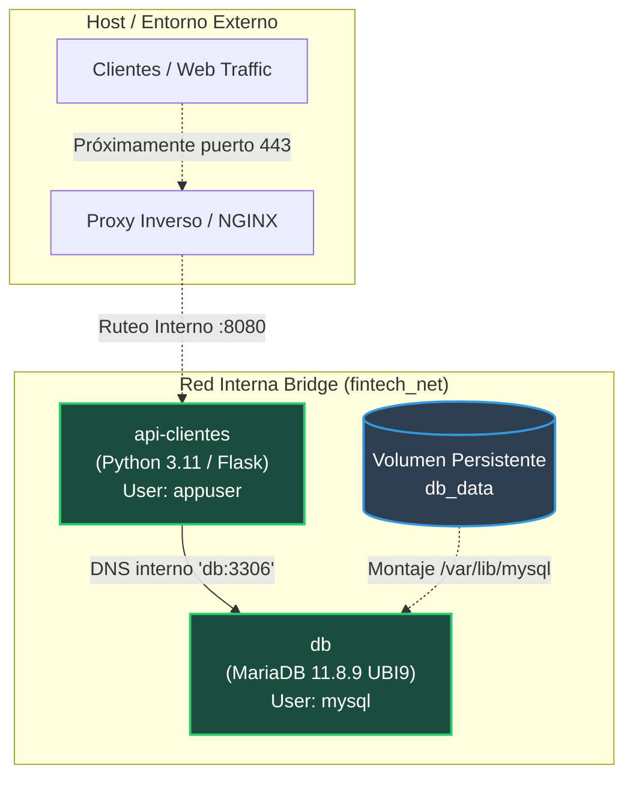

# 🚀 FinTech Nova — Plataforma de Microservicios Distribuidos

<div align="center">


**Trabajo Práctico DevOps — Grupo 6**  
*Plataforma bancaria contenerizada con arquitectura de microservicios, aislamiento de red y endurecimiento de seguridad (hardening).*

Enunciado: (./Enunciado-TP-Parte-1.md)

[Imágenes en Docker Hub](#-imágenes-oficiales-en-docker-hub) • [Arquitectura](#-arquitectura-y-topología-de-red) • [Servicios](#-catálogo-de-servicios) • [Seguridad](#-decisiones-de-diseño-y-seguridad) • [Despliegue](#-guía-de-despliegue-local)

</div>

---

## 📌 1. Introducción a la Solución

**FinTech Nova** es una plataforma orientada a servicios financieros diseñada para operar bajo altos estándares de disponibilidad, seguridad y resiliencia.

Este repositorio implementa la infraestructura base de la plataforma mediante:
1. Un **servidor centralizado de persistencia relacional** (`MariaDB 11.8.9`) con aprovisionamiento automatizado y particionamiento lógico de esquemas.
2. El primer microservicio de dominio: **`api-clientes`** (Python 3.11 / Flask), empaquetado bajo un proceso de compilación multietapa (*Multistage Build*) y ejecutado bajo un usuario sin privilegios (*non-root*).
3. Una red interna aislada (`fintech_net`) que previene la exposición accidental de puertos al exterior y restringe el acceso estrictamente a resolución DNS interna.

---

## 🏗️ 2. Arquitectura y Topología de Red

El diseño de red sigue el principio de **menor exposición**: ningún contenedor de base de datos ni de API de lógica de negocio mapea puertos directamente al host.



---

## 📦 3. Catálogo de Servicios

| Servicio | Lenguaje / Base | Puerto Interno | Mapeo al Host | Usuario Runtime | Límites (CPU / RAM) |
|---|---|---|---|---|---|
| **`db`** | `mariadb:11.8.9-ubi9` | `3306` | ❌ *Ninguno* | `mysql` | 0.50 CPU / 512 MB |
| **`api-clientes`** | `python:3.11-slim` | `8080` | ❌ *Ninguno* | `appuser` (UID no-root) | 0.30 CPU / 256 MB |

> [!NOTE]
> Próximamente se integrarán los servicios `api-pagos` (Node.js), `api-facturas` (Java/Spring Boot), `api-transacciones` (Go), `api-tarjetas` (.NET) y el frontend `web` (NGINX con TLS en puerto 443).

---

## 🛡️ 4. Decisiones de Diseño y Hardening de Seguridad

### A. Compilación Multietapa (*Multistage Build*)
Para `api-clientes`, se implementó una estrategia en dos etapas:
* **Etapa 1 (`builder`):** Crea el entorno virtual (`/opt/venv`), descarga dependencias vía `pip` y ejecuta compilaciones requeridas.
* **Etapa 2 (`runtime`):** Parte de una imagen limpia `python:3.11-slim`, copia únicamente el artefacto precompilado `/opt/venv` y el código fuente.
* **Beneficio:** Reduce drásticamente la superficie de ataque y el peso final de la imagen al eliminar compiladores, paquetes de desarrollo y cachés temporales de pip.

### B. Ejecución No Privilegiada (*Non-Root User*)
* En `api-clientes`, se crea un usuario de sistema dedicado sin shell de inicio ni permisos de superusuario (`RUN adduser --disabled-password --no-create-home appuser`).
* El contenedor ejecuta el proceso de Flask bajo `USER appuser`, mitigando riesgos de escape de contenedor (*container breakout*).

### C. Red Aislada y Sin Puertos Expuestos
* Ni la base de datos ni `api-clientes` exponen puertos hacia el host (`ports: "..."` fue eliminado deliberadamente).
* La comunicación inter-servicio se realiza exclusivamente mediante resolución DNS interna a través de la red `fintech_net` (`host: db`, `port: 3306`).

### D. Aislamiento Lógico de Bases de Datos
* Una única instancia de MariaDB aloja esquemas independientes (`db_clientes`, `db_pagos`, etc.).
* El script inicial `00-databases.sh` crea las bases restantes y parametriza los permisos bajo principio de privilegio mínimo por microservicio.

### E. Gestión de Secretos y Límites de Cómputo
* **Cero Secretos Hardcodeados:** Se desacoplan las variables de configuración mediante archivos `.env` y directivas `env_file`, excluidos en `.dockerignore` y `.gitignore`.
* **Protección contra DoS / Saturation:** Límites rígidos de recursos (`deploy.resources.limits`) aplicados para garantizar estabilidad en instancias t3.medium.

---

## 🚀 5. Guía de Despliegue Local

### Prerrequisitos
* [Docker Engine](https://docs.docker.com/engine/install/) versión 24.0 o superior.
* [Docker Compose](https://docs.docker.com/compose/) v2.x+.

### Pasos para levantar la plataforma

1. **Clonar el repositorio:**
   ```bash
   git clone <URL_DEL_REPOSITORIO>
   cd enunciado-tp1/aplicaciones-contenedores
   ```

2. **Configurar las variables de entorno:**
   Copiar los archivos de ejemplo y configurar las credenciales locales:
   ```bash
   cp db/env.example db/.env
   cp api-clientes/env.example api-clientes/.env
   ```

3. **Iniciar los servicios con Docker Compose:**
   ```bash
   docker compose up -d
   ```

4. **Verificar el estado de los contenedores:**
   ```bash
   docker compose ps
   ```

---

## 🐳 6. Imágenes Oficiales en Docker Hub

Las imágenes son construidas y versionadas siguiendo estándares semánticos:

* 🗄️ **Base de Datos:** [`fabripeveraro/db:1.0.0`](https://hub.docker.com/r/fabripeveraro/db)
* 👤 **API Clientes:** [`fabripeveraro/api-clientes:1.0.0`](https://hub.docker.com/r/fabripeveraro/api-clientes)

---

## 📈 7. Próximos Pasos Identificados

* [ ] Integración de **Healthchecks** activos en MariaDB para condicionar el arranque de APIs dependientes (`condition: service_healthy`).
* [ ] Incorporación de servidor WSGI de producción (`gunicorn`) para `api-clientes`.
* [ ] Integración de los 4 microservicios backend restantes.
* [ ] Configuración del reverse proxy NGINX con terminación TLS autofirmada en puerto 443.
* [ ] Script de despliegue automatizado `deploy.sh` en instancia EC2 de AWS.
* [ ] **Gestión Centralizada de Secretos:** Reemplazar progresivamente los archivos `.env` locales por mecanismos centralizados de gestión de secretos (ej. AWS Secrets Manager o HashiCorp Vault) al escalar a entornos productivos.
