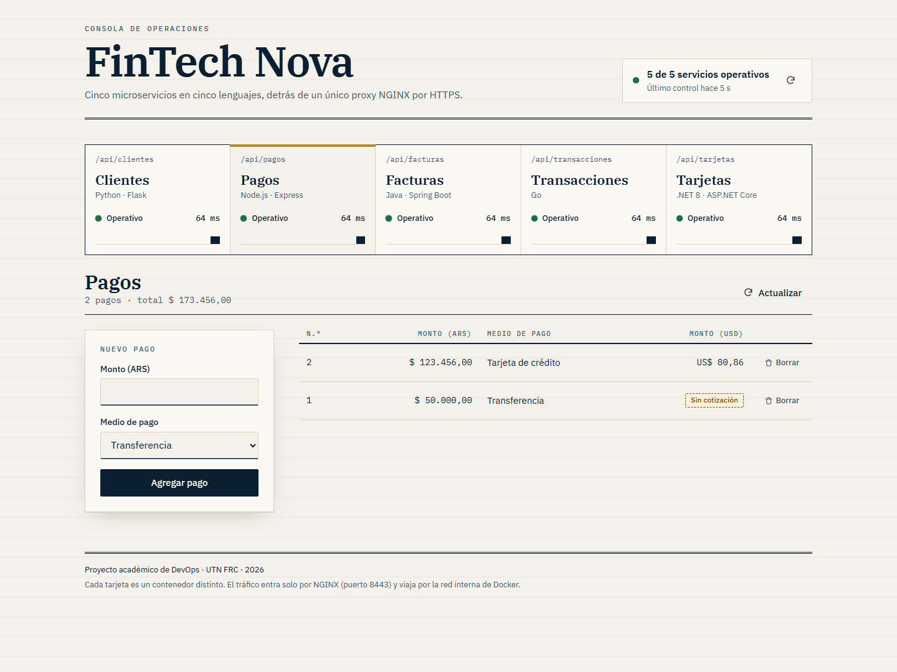
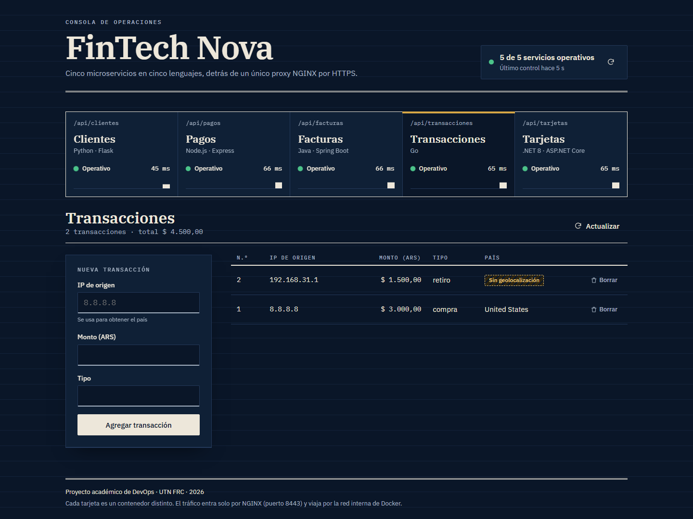
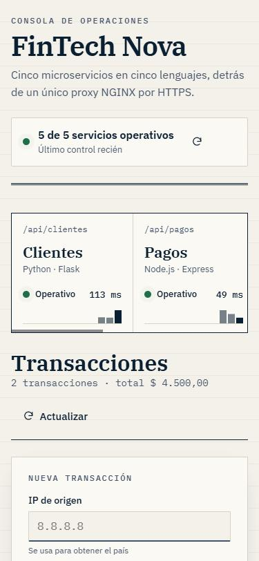
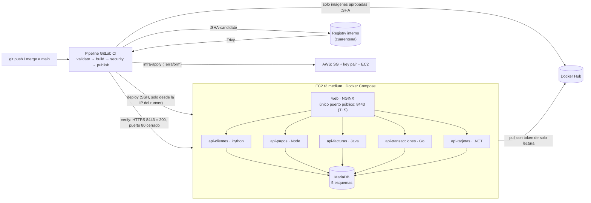
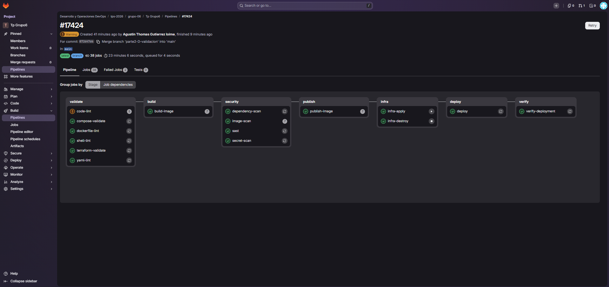
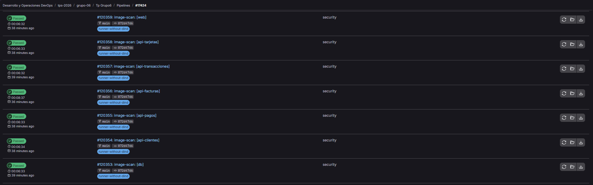
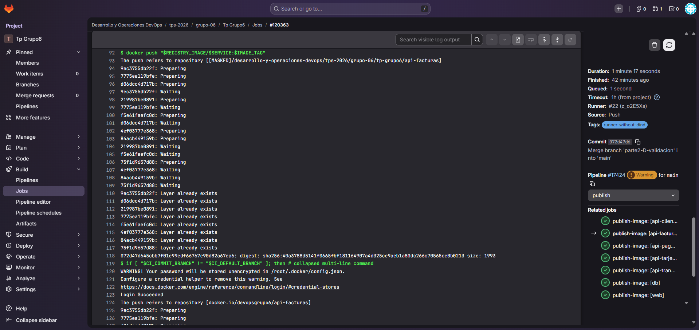
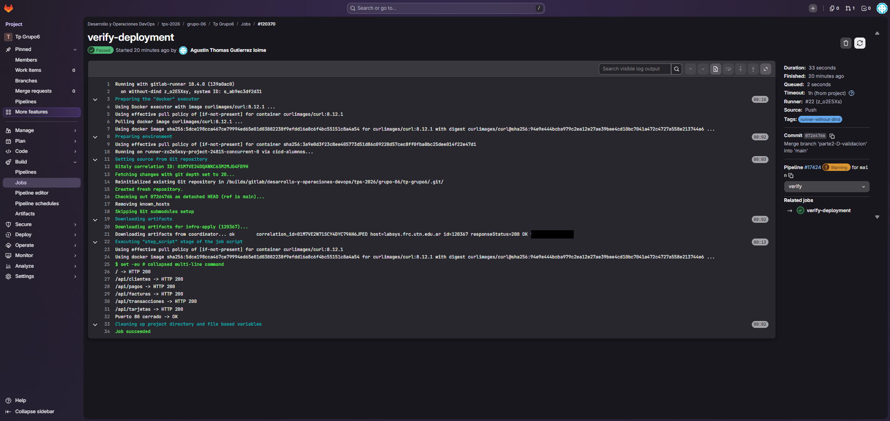
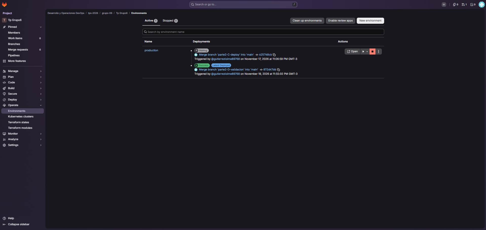
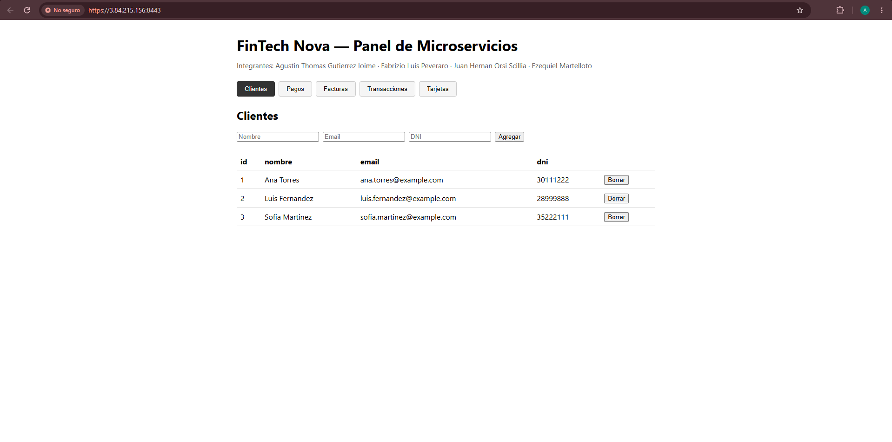

# FinTech Nova — Microservicios en contenedores, del commit a AWS

[](https://github.com/agusgut0/fintech-nova/actions/workflows/ci.yml)
[](https://agusgut0.github.io/fintech-nova/)


🇬🇧 [English version](./README.en.md)

Plataforma bancaria de **5 APIs en 5 lenguajes** (Python, Node.js, Java, Go y .NET), una base MariaDB y un proxy NGINX. Está contenerizada, se escanea en cada commit y se despliega en **AWS EC2** con un pipeline que crea la infraestructura con **Terraform**, despliega y verifica el resultado.

Es el trabajo práctico integrador de *Desarrollo y Operaciones (DevOps)*, de Ingeniería en Sistemas (UTN FRC, 2026), hecho por un equipo de 4 personas. **Nota: 10.**



<details>
<summary>Modo oscuro y mobile</summary>





</details>

<sub>Capturas con datos de ejemplo. **[Probá la demo en vivo](https://agusgut0.github.io/fintech-nova/)**: es la consola real, con las APIs simuladas en el navegador ([`demo.js`](./aplicaciones-contenedores/web/src/demo.js)). El stack completo se levanta con el quick start de abajo.</sub>

---

## En 30 segundos

| Problema | Qué hicimos | Resultado medible |
|---|---|---|
| Las imágenes se construían en la PC de un integrante y nadie las escaneaba. | Pipeline con build en paralelo y gate de Trivy, Semgrep, Gitleaks y Hadolint. | **13 vulnerabilidades críticas** encontradas y corregidas en el primer escaneo. |
| Escanear 7 imágenes una por una tardaba demasiado. | `parallel: matrix`: un job por imagen. | Unos **48 min → 8,5 min** en el stage de escaneo. |
| La EC2 y el Security Group se creaban a mano en cada sesión del sandbox. | Terraform dentro del pipeline, con estado remoto en GitLab. | **6 recursos** recreados desde cero con un clic, con disco cifrado e IMDSv2. |
| `api-facturas` (Spring Boot) tardaba en arrancar y el frontend mostraba tablas vacías. | Healthcheck + `depends_on: service_healthy` + flags de la JVM. | Arranque de **45,6 s → ~1 s**. |
| Un "deploy en verde" no garantiza que la app ande. | Job `verify-deployment` por HTTPS. | 6 endpoints en HTTP 200 **y** el puerto 80 cerrado, en cada deploy. |

## Mi rol

Integrante a cargo del **despliegue en AWS**: la infraestructura en Terraform (EC2, Security Group, key pair), los jobs `infra-apply`, `deploy` y `verify-deployment`, el manejo de secretos del deploy (variables de tipo File, token de solo lectura con vencimiento, `known_hosts` verificado contra la API de AWS) y la documentación de operación ([AWS_EC2.md](./AWS_EC2.md)). Además participé en la dockerización y en la revisión de todo el pipeline, porque en la defensa oral cualquier integrante podía ser consultado sobre cualquier parte.

---

## Arquitectura



- **Un solo puerto público.** `web` (NGINX, sin root) termina TLS en `8443` y rutea `/api/<svc>` por la red interna. Ni las APIs ni la base publican puertos, y el pipeline lo exige ([ADR-0001](./docs/adr/0001-nginx-unico-punto-de-entrada.md)).
- **Imagen escaneada = imagen desplegada.** Las candidatas quedan en cuarentena en un registry interno y solo las que pasan Trivy salen a Docker Hub, con el mismo digest ([ADR-0003](./docs/adr/0003-registry-interno-como-cuarentena.md)).
- **Trazabilidad.** El tag de cada imagen es el SHA del commit, nunca `latest`.
- **Degradación controlada.** Si fallan las APIs externas (tipo de cambio y geolocalización), el ABM sigue funcionando y solo falta el dato enriquecido.

## Probarlo en 3 comandos

Requisitos: Docker con Compose v2, `openssl` y `curl`.

```bash
cd aplicaciones-contenedores
sh generar-env.sh   # crea los 6 .env con contraseñas aleatorias (no se versionan)
mkdir -p certs && openssl req -x509 -nodes -days 365 -newkey rsa:2048 -keyout certs/key.pem -out certs/cert.pem -subj "/CN=localhost" && chmod 644 certs/*.pem
# Imágenes publicadas en Docker Hub por el último pipeline de main (tag = SHA del commit en el GitLab original)
IMAGE_TAG=a7aebcac8ae676d6e0d3264a48b48c02c42d3969 docker compose up -d --wait
```

Abrir `https://localhost:8443` (el certificado es autofirmado) o correr el smoke test:

```bash
for ep in / /api/clientes /api/pagos /api/facturas /api/transacciones /api/tarjetas; do
  curl -k -s -o /dev/null -w "$ep %{http_code}\n" "https://localhost:8443$ep"
done
```

> Los tags SHA de Docker Hub corresponden al repositorio original de GitLab. Este repositorio tiene el mismo código, pero otros SHA, porque el historial se limpió antes de publicarlo. Para construir las imágenes localmente, ver el job `smoke-test` de [`ci.yml`](./.github/workflows/ci.yml).

---

## Pipelines

| | GitLab CI ([`.gitlab-ci.yml`](./.gitlab-ci.yml)) | GitHub Actions ([`ci.yml`](./.github/workflows/ci.yml)) |
|---|---|---|
| Rol | **Pipeline real del proyecto**, con deploy a AWS | Espejo para este repositorio público, más la [demo en GitHub Pages](./.github/workflows/pages.yml) |
| Validación | yamllint, Hadolint, ShellCheck, Compose contra reglas propias, `terraform validate`, linters de los 5 lenguajes | Lo mismo, sin los linters de lenguajes |
| Seguridad | Gitleaks (todo el historial), Semgrep, Trivy fs y Trivy por imagen | Gitleaks, Semgrep y Trivy por imagen, con hallazgos en la pestaña **Security** (SARIF) |
| Build | 7 imágenes en paralelo → registry interno | 7 imágenes en paralelo |
| Entrega | `publish` → Docker Hub, `infra-apply` (Terraform), `deploy` (SSH), `verify` | `smoke-test`: el stack completo levantado en el runner, con la misma verificación que `verify` |

El deploy no se replica en GitHub porque el sandbox de AWS Academy existe solo mientras dura una sesión. El detalle de cada job y de las variables está en [PIPELINE.md](./PIPELINE.md).

### Política de seguridad (resumen)

| Control | Corta si… |
|---|---|
| Gitleaks | Hay cualquier secreto en el historial. |
| Semgrep | Hay hallazgos `ERROR`. |
| Hadolint | Hay errores, o el último `USER` es root. |
| Compose | Un servicio distinto de `web` publica puertos, o falta `restart`, límites, `cap_drop: [ALL]`, `read_only`, `no-new-privileges` o rotación de logs. |
| Trivy (imagen) | Hay una vulnerabilidad `CRITICAL` **con parche**. Las que no tienen parche se aceptan con justificación y fecha de revisión ([ADR-0004](./docs/adr/0004-politica-de-corte-de-vulnerabilidades.md)). |

Hardening completo, hallazgos y riesgos aceptados: [SEGURIDAD.md](./SEGURIDAD.md).

---

## Decisiones, operación e incidentes

| Tipo | Documento |
|---|---|
| **ADR**: por qué esto y no otra cosa | [0001 NGINX como único punto de entrada](./docs/adr/0001-nginx-unico-punto-de-entrada.md) · [0002 Una MariaDB, un esquema por dominio](./docs/adr/0002-una-mariadb-esquema-por-dominio.md) · [0003 Registry interno como cuarentena](./docs/adr/0003-registry-interno-como-cuarentena.md) · [0004 Política de corte de vulnerabilidades](./docs/adr/0004-politica-de-corte-de-vulnerabilidades.md) |
| **Runbook**: qué hacer cuando algo se rompe | [Una API devuelve 502](./docs/runbooks/api-devuelve-502.md) · [Falla el deploy en el pipeline](./docs/runbooks/deploy-falla-en-el-pipeline.md) |
| **Postmortem** (sin culpables) | [`infra-destroy` borró producción](./docs/postmortems/2026-11-19-infra-destroy-borro-produccion.md) · [`x509` "intermitente" en el escaneo](./docs/postmortems/2026-11-image-scan-x509-intermitente.md) |
| **Registro de errores** | [ERRORES.md](./ERRORES.md): 48 errores reales, con causa y solución |

## Qué haría distinto

1. **La base fuera de la EC2.** RDS con backups automáticos: hoy, si se pierde la instancia, se pierden los datos.
2. **Más de una instancia** detrás de un balanceador, en dos zonas de disponibilidad. Hoy la EC2 es un punto único de falla.
3. **Rollback automático** si `verify-deployment` falla, volviendo a desplegar el SHA anterior.
4. **`infra-destroy` difícil de disparar por accidente**, en una etapa propia y con confirmación (ver el postmortem).
5. **DAST con OWASP ZAP** después del deploy, y un **SBOM** por imagen.
6. **Monitoreo y alertas.** Hoy una caída se detecta cuando alguien la ve.

---

## Cómo usé IA en este proyecto

Usé **Claude Code** (un asistente de programación con IA que trabaja en la terminal) durante todo el proyecto, configurado como **mentor** y no como generador de código:

- **Instrucciones del proyecto.** Un archivo de contexto con mi perfil, las decisiones ya tomadas y reglas de trabajo: no editar archivos sin pedido explícito, explicar el porqué de cada propuesta citando la clase y la sección del material de la cátedra, y presentar un plan breve para aprobar antes de escribir código.
- **Memoria persistente con reglas de trabajo**: código comentado, documentación al día y alternativas de nivel industria discutidas antes de decidir.
- **Registro automático de errores.** Cada error real que aparecía (en el pipeline, el deploy o la EC2) se agregaba a [ERRORES.md](./ERRORES.md) con título, error, causa y solución. Así se juntaron las 48 entradas que después alimentaron los postmortems y la demo.
- **Revisión de documentación contra el código.** Al pedirle revisar un documento, el asistente lo comparaba con el código real. Así apareció el [error 43](./ERRORES.md): dos correcciones documentadas que nunca se habían commiteado.
- **Límites explícitos (*guardrails*)** en la configuración del asistente: sin permiso para `git commit` ni `git push` (los commits los hice yo) y sin permiso de lectura sobre `.env`, `certs/` ni `*.pem`. El asistente nunca tuvo acceso a los secretos.
- **Preparación de este repositorio público.** Con el asistente revisé el historial en busca de secretos, quité material de terceros del historial, tapé datos de la cuenta de AWS en las capturas y redacté los ADR, runbooks, postmortems y el workflow de GitHub Actions. Todo lo revisé y corregí yo.

**Lo que no delegué:** las decisiones de arquitectura y de seguridad, las pruebas en el sandbox de AWS y la defensa oral. En la defensa tuve que explicar cualquier parte del pipeline sin ayuda, y es lo que puedo hacer en una entrevista.

---

## Evidencia

<details>
<summary>Pipeline en GitLab, escaneo en paralelo, verificación y app en AWS</summary>








</details>

Más capturas y el informe completo de la entrega: [docs/informe-tp.md](./docs/informe-tp.md).

## Estructura del repositorio

```
├── aplicaciones-contenedores/   # 7 servicios: Dockerfile + .dockerignore cada uno, y docker-compose.yml
├── infra/                       # Terraform: Security Group, key pair y EC2
├── ci/                          # script de linting por lenguaje (job code-lint)
├── .gitlab-ci.yml               # pipeline real: validate → build → security → publish → infra → deploy → verify
├── .github/workflows/ci.yml     # CI espejo en GitHub Actions
├── docs/                        # ADR, runbooks, postmortems e informe de la entrega
├── PIPELINE.md · SEGURIDAD.md · AWS_EC2.md · ERRORES.md · DEMO.md
└── deploy.sh                    # deploy manual de la primera entrega (lo reemplazó el pipeline)
```

## Créditos

- **Equipo:** Agustin Thomas Gutierrez Ioime, Fabrizio Luis Peveraro, Juan Hernan Orsi Scillia y Ezequiel Martelloto.
- **Cátedra de DevOps, UTN FRC:** el código fuente de las 5 APIs, la primera versión del frontend y el enunciado del trabajo práctico. El equipo hizo los Dockerfiles, el Compose, el pipeline, la infraestructura y la documentación.
- **Consola web:** la rediseñé después de la entrega como "consola de operaciones". Muestra el estado y la latencia de cada microservicio, hace visible la degradación cuando fallan las APIs externas ("Sin cotización", "Sin geolocalización") y maneja errores, estados de carga y borrado con confirmación. Es accesible (contraste AA y navegación por teclado), tiene modo claro y oscuro, y usa fuentes autoalojadas para respetar la CSP `default-src 'self'` de NGINX.
