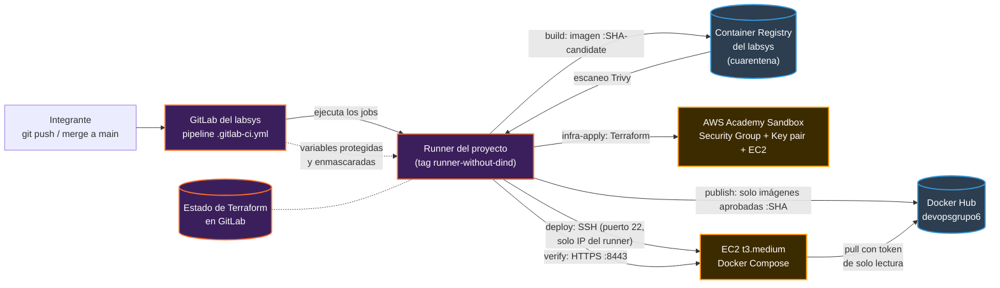
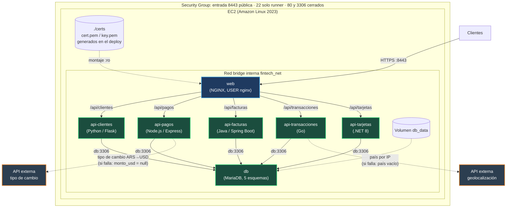
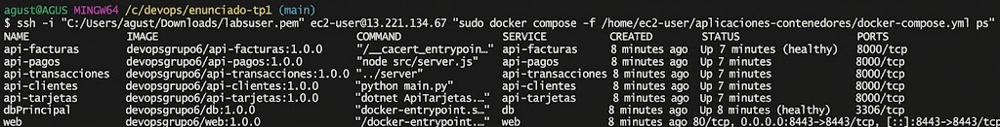
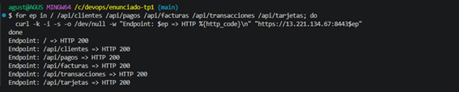
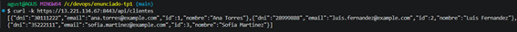
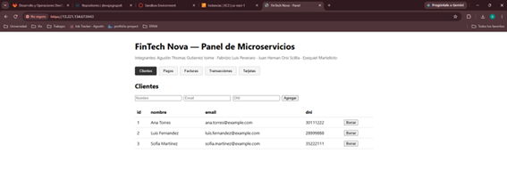
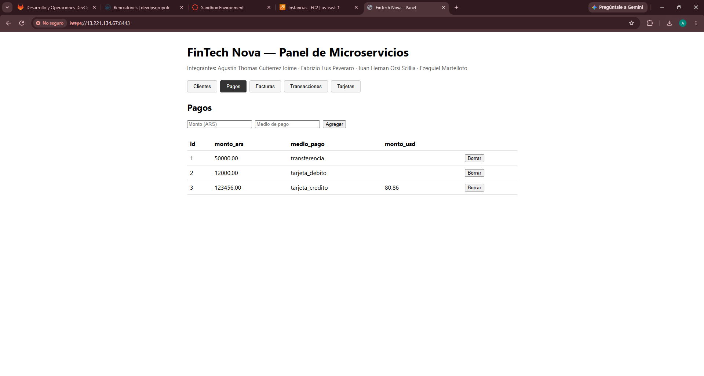

# 🚀 FinTech Nova — Plataforma de Microservicios Distribuidos

<div align="center">


**Trabajo Práctico DevOps — Grupo 6**
*Plataforma bancaria contenerizada que se valida, escanea, publica y despliega en AWS mediante un pipeline de GitLab CI/CD.*

**Integrantes:** Agustin Thomas Gutierrez Ioime • Fabrizio Luis Peveraro • Juan Hernan Orsi Scillia • Ezequiel Martelloto

Enunciados: [Parte 1](./Enunciado-TP-Parte-1.md) | [Parte 2](./Enunciado-TP-Parte-2.md)
Documentación: [PIPELINE.md](./PIPELINE.md) | [SEGURIDAD.md](./SEGURIDAD.md) | [AWS_EC2.md](./AWS_EC2.md) | [ERRORES.md](./ERRORES.md) | [DEMO.md](./DEMO.md) (Sprint Demo)
Imágenes: [Container Registry del proyecto (labsys)](https://labsys.frc.utn.edu.ar/gitlab/desarrollo-y-operaciones-devops/tps-2026/grupo-06/tp-grupo6/container_registry) | [Docker Hub `devopsgrupo6`](https://hub.docker.com/u/devopsgrupo6)

[Arquitectura](#️-2-arquitectura) • [Pipeline](#-3-pipeline-de-cicd) • [Servicios](#-4-catálogo-de-servicios) • [Hardening](#️-5-decisiones-de-diseño-y-hardening) • [Mejoras](#-6-mejoras-respecto-de-la-parte-1) • [Despliegue](#-7-despliegue-y-pruebas) • [Evidencia](#-8-evidencia) • [Para pensar](#-9-para-pensar--responder)

</div>

---

## 📌 1. Introducción

**FinTech Nova** es una plataforma de servicios financieros compuesta por:

1. Una **base de datos MariaDB** con un esquema por dominio y aprovisionamiento automático.
2. **Cinco APIs de dominio** contenerizadas con *multistage builds* y usuarios no privilegiados: `api-clientes` (Python/Flask), `api-pagos` (Node.js/Express), `api-facturas` (Java/Spring Boot), `api-transacciones` (Go) y `api-tarjetas` (.NET).
3. Un **frontend con proxy inverso** (`web`, NGINX) que es el **único punto de entrada**, por HTTPS en el puerto `8443`.
4. Una red interna aislada (`fintech_net`): ni las APIs ni la base de datos publican puertos.

**Qué cambió en la Parte 2.** El stack y sus requisitos son los mismos de la Parte 1. Lo que cambió es cómo se entrega: en la Parte 1 un integrante construía las imágenes en su PC y desplegaba con [`deploy.sh`](./deploy.sh). Ahora cada cambio en `main` pasa por un **pipeline de GitLab** que valida, construye, escanea y publica las imágenes, crea la infraestructura en AWS con **Terraform**, despliega en la EC2 y **verifica** que la aplicación responda.

---

## 🏗️ 2. Arquitectura

### A. Flujo de entrega: del commit a la EC2



- El **registry del labsys** guarda las imágenes candidatas mientras se escanean. La EC2 no puede acceder a él porque solo existe dentro de la red de la facultad ([ERRORES.md](./ERRORES.md), error 39), así que `publish` sube a **Docker Hub** únicamente las imágenes que pasaron los controles. Una imagen con fallas no sale nunca del registry interno.
- La EC2 se crea en cada sesión del sandbox con Terraform ([`infra/`](./infra/)). El procedimiento está en [AWS_EC2.md](./AWS_EC2.md).

### B. Topología de la aplicación dentro de la EC2



- NGINX rutea `/api/<servicio>` a `http://api-<servicio>:8080/<servicio>` resolviendo por el DNS interno de Docker.
- Las 5 APIs esperan a que `db` esté sana (`service_healthy`) y `web` espera el healthcheck de `api-facturas`, la de arranque más lento.

---

## 🔁 3. Pipeline de CI/CD

Definido en [`.gitlab-ci.yml`](./.gitlab-ci.yml). El detalle de cada job y la tabla de variables de CI/CD están en [PIPELINE.md](./PIPELINE.md).

### A. Diagrama

```mermaid
flowchart LR
    subgraph validate ["1 · validate"]
        direction TB
        YL["yaml-lint<br/>pipeline y compose"]
        CV["compose-validate<br/>esquema + reglas del TP"]
        HL["dockerfile-lint 🛡️<br/>Hadolint"]
        SC["shell-lint<br/>ShellCheck"]
        TV["terraform-validate"]
    end

    subgraph earlysec ["security (arranca con el pipeline, needs: [])"]
        direction TB
        GLK["secret-scan 🛡️<br/>Gitleaks, todo el historial"]
        SG["sast 🛡️<br/>Semgrep"]
        DEP["dependency-scan 🛡️<br/>Trivy fs (solo informa)"]
    end

    subgraph build ["2 · build — 7 jobs en paralelo"]
        B["build-image<br/>db · web · 5 APIs<br/>→ :SHA-candidate"]
    end

    subgraph security ["3 · security — 7 jobs en paralelo"]
        IS["image-scan 🛡️<br/>Trivy por imagen"]
    end

    subgraph publish ["4 · publish — 7 jobs en paralelo"]
        P["publish-image<br/>:SHA en labsys<br/>+ Docker Hub (main)"]
    end

    subgraph infra ["5 · infra (manual, solo main)"]
        IA["▶ infra-apply<br/>Terraform"]
        ID["▶ infra-destroy<br/>(opcional)"]
    end

    subgraph deploy ["6 · deploy"]
        D["deploy<br/>SSH → EC2<br/>compose up"]
    end

    subgraph verify ["7 · verify"]
        V["verify-deployment<br/>6 endpoints HTTPS = 200<br/>puerto 80 cerrado"]
    end

    validate --> build --> security --> publish --> IA --> D --> V
    earlysec --> publish
```



🛡️ = control de seguridad. Un control que falla **corta el pipeline antes de `publish`**: la imagen no se publica y, por lo tanto, no se despliega.

### B. Qué hace cada etapa y por qué

| Stage | Jobs | Paralelismo | Para qué |
|---|---|---|---|
| `validate` | `yaml-lint`, `compose-validate`, `dockerfile-lint`, `shell-lint`, `terraform-validate` | Los 5 a la vez | Frenar errores de sintaxis y malas prácticas antes de gastar tiempo en el build. `compose-validate` además rechaza un compose que publique puertos fuera de `web:8443` o que no tenga `restart: always` y límites de recursos en todos los servicios. |
| `security` (código) | `secret-scan`, `sast`, `dependency-scan` | Los 3 a la vez, **en paralelo con validate y build** (`needs: []`) | No necesitan imágenes: analizan el repositorio desde el primer segundo. |
| `build` | `build-image` × 7 | `parallel: matrix`, un job por servicio | Construir las 7 imágenes y subirlas como candidatas (`<servicio>:<SHA>-candidate`). |
| `security` (imágenes) | `image-scan` × 7 | `parallel: matrix` | Buscar vulnerabilidades en cada imagen construida. |
| `publish` | `publish-image` × 7 | `parallel: matrix` | Re-etiquetar como `<servicio>:<SHA>` y, en `main`, subir a Docker Hub. |
| `infra` | `infra-apply` (▶ manual), `infra-destroy` (▶ opcional) | — | Crear o borrar la EC2 y el Security Group. Es manual porque el sandbox está apagado la mayor parte del tiempo; mientras no se ejecuta, el pipeline queda en verde. |
| `deploy` | `deploy` | — | Preparar la EC2 desde cero (Docker, Compose, certificado), descargar las imágenes del commit y levantar el stack. |
| `verify` | `verify-deployment` | — | Confirmar por HTTPS que la web y las 5 APIs responden 200 y que el puerto 80 está cerrado. Un deploy en verde sin verificación no alcanza. |

### C. Decisiones clave

- **Versionado:** cada imagen lleva el **SHA del commit**. Lo desplegado siempre se puede rastrear hasta una revisión concreta y no se depende de `latest`.
- **Runner:** todos los jobs usan el runner del proyecto, seleccionado por su tag (`runner-without-dind`). Es el runner asignado al grupo y tiene salida a internet, que el pipeline necesita para llegar a Docker Hub y a AWS.
- **Secretos:** ningún secreto está en el repositorio ni en el `.gitlab-ci.yml`. Los `.env`, la llave SSH y los tokens son variables de CI/CD protegidas (y enmascaradas cuando GitLab lo permite). Las credenciales del despliegue solo existen en el entorno `production`. Detalle en [SEGURIDAD.md §5](./SEGURIDAD.md#5-gestión-de-secretos-en-gitlab-y-autenticación-del-despliegue).
- **Entorno y concurrencia:** `deploy` usa `environment: production`, que deja en GitLab el enlace a la aplicación, y `resource_group`, que evita que dos despliegues pisen la misma EC2.
- **Artifacts:** los reportes de todos los controles quedan descargables desde el pipeline, aun cuando el job falla.

### D. Política ante vulnerabilidades (resumen)

| Control | Corta el pipeline si… |
|---|---|
| Secretos (Gitleaks) | Detecta cualquier secreto en el historial. |
| SAST (Semgrep) | Hay hallazgos de severidad `ERROR`. |
| Dockerfiles (Hadolint) | Hay errores o el último `USER` es root. |
| Compose (`compose-validate`) | Un servicio distinto de `web` publica puertos, `web` publica otro que no sea `8443`, o falta `restart: always` o los límites. |
| Scripts (ShellCheck) | Hay advertencias o errores. |
| Imágenes (Trivy) | Hay una vulnerabilidad `CRITICAL` **con parche disponible**. |
| Dependencias (Trivy fs) | No corta: informa `HIGH` y `CRITICAL` como advertencia. |

Criterio: se corta lo que tiene una solución accionable hoy. Los riesgos aceptados quedan registrados con su justificación y una fecha de revisión. Política completa y hallazgos en [SEGURIDAD.md §4](./SEGURIDAD.md#4-seguridad-integrada-en-el-pipeline-parte-2).

---

## 📦 4. Catálogo de Servicios

| Servicio | Base (builder → runtime) | Puerto interno | Mapeo al host | Usuario runtime | Límites (CPU / RAM) |
|---|---|---|---|---|---|
| **`db`** | `mariadb:11.8.9-ubi9` | `3306` | ❌ Ninguno | `mysql` | 0.50 CPU / 512 MB |
| **`api-clientes`** | `python:3.11-slim` → `python:3.11-slim` | `8080` | ❌ Ninguno | `appuser` | 0.30 CPU / 256 MB |
| **`api-pagos`** | `node:22-alpine3.21` → `alpine:3.21` (nodejs) | `8080` | ❌ Ninguno | `app` | 0.30 CPU / 256 MB |
| **`api-facturas`** | `maven:3.9.6-eclipse-temurin-21-alpine` → `eclipse-temurin:21-jre-alpine` | `8080` | ❌ Ninguno | `appuser` | 2.00 CPU / 256 MB |
| **`api-transacciones`** | `golang:1.25` → `alpine:3.19` | `8080` | ❌ Ninguno | `appuser` | 0.30 CPU / 256 MB |
| **`api-tarjetas`** | `mcr.microsoft.com/dotnet/sdk:8.0` → `aspnet:8.0` | `8080` | ❌ Ninguno | `appuser` | 0.30 CPU / 256 MB |
| **`web`** | `node:20-alpine` → `nginx:1.25-alpine` | `8443` (TLS) | ✅ `8443:8443` | `nginx` | 0.30 CPU / 256 MB |

Todos los servicios tienen `restart: always`. Las imágenes se referencian como `${REGISTRY_IMAGE}/<servicio>:${IMAGE_TAG}`: `deploy` escribe esos valores en la EC2 (Docker Hub y SHA del commit). Sin esas variables, el compose usa las imágenes de la Parte 1 (`devopsgrupo6/<servicio>:1.0.0`).

---

## 🛡️ 5. Decisiones de Diseño y Hardening

### A. Compilación multietapa (*multistage build*)
* **`api-clientes`:** la etapa `builder` crea el entorno virtual (`/opt/venv`) e instala las dependencias; la etapa `runtime` copia solo el entorno virtual y el código.
* **`api-pagos`:** la etapa `deps` instala las dependencias de producción (`npm ci --omit=dev`); el runtime parte de `alpine:3.21` con `nodejs` y usa `init: true` en Compose para manejar las señales correctamente.
* **`api-facturas`:** Maven empaqueta el `.jar` y el runtime usa solo el JRE (sin JDK ni Maven), con opciones de la JVM para acelerar el arranque.
* **`api-transacciones`:** se compila un binario estático (`CGO_ENABLED=0`) y el runtime parte de `alpine:3.19` con el ejecutable y `ca-certificates`.
* **`api-tarjetas`:** `dotnet publish -c Release`; el runtime usa `aspnet:8.0` sin el SDK.
* **`web`:** Node compila los estáticos y NGINX los sirve.
* **Beneficio:** imágenes más chicas y sin compiladores ni gestores de paquetes en producción, es decir, menos superficie de ataque.

### B. Ejecución sin root
* Todos los contenedores corren con usuarios sin privilegios (`appuser`, `app`, `nginx`, `mysql`). Hadolint lo verifica en cada pipeline: falla si el último `USER` de un Dockerfile es root.
* `web` escucha en el puerto no privilegiado `8443` con `USER nginx`, sin necesitar root ni capacidades adicionales del kernel.

### C. TLS y red aislada
* **Certificado fuera de la imagen:** el par `cert.pem`/`key.pem` se genera en la EC2 durante el deploy y se monta como solo lectura (`./certs:/etc/nginx/certs:ro`). Nunca está en la imagen ni en el repositorio.
* **Único punto de entrada:** solo `web` publica un puerto (`8443`). El `80` está cerrado y `verify-deployment` lo comprueba en cada despliegue.

### D. Aislamiento lógico de la base de datos
* Una instancia de MariaDB con 5 esquemas (`db_clientes`, `db_pagos`, `db_facturas`, `db_transacciones`, `db_tarjetas`). `00-databases.sh` los crea y da permisos al usuario de aplicación: ninguna API usa `root`.

### E. Secretos, healthchecks y límites
* **Secretos:** se inyectan con `env_file`. Los `.env` están excluidos en `.gitignore` y `.dockerignore`, y en la Parte 2 llegan a la EC2 desde variables de tipo File de GitLab.
* **Orden de arranque:** las APIs esperan a `db` (`service_healthy`) y `web` espera a `api-facturas`.
* **Límites de recursos** en todos los servicios, dimensionados para una `t3.medium`, con `restart: always`.

### F. Resiliencia ante APIs externas
* **`api-pagos`:** si el servicio de tipo de cambio no responde en 5 segundos o devuelve error, el pago se guarda igual con `monto_usd = null`.
* **`api-transacciones`:** si la geolocalización falla (por ejemplo, por límite de consultas desde AWS), la transacción se guarda con `pais` vacío ([ERRORES.md](./ERRORES.md), error 23).
* En ambos casos el ABM sigue funcionando: solo falta el dato enriquecido.

---

## 📈 6. Mejoras respecto de la Parte 1

### A. Mejoras que la Parte 1 dejó anotadas como "posibles mejoras futuras"

| Mejora anotada en la Parte 1 | Estado | Detalle |
|---|---|---|
| Escaneo de vulnerabilidades de imágenes en un pipeline CI/CD | ✅ **Implementada** | Trivy escanea las 7 imágenes en cada pipeline, junto con Hadolint, Semgrep, Gitleaks y el análisis de dependencias. Ver [§3](#-3-pipeline-de-cicd). |
| Gestión centralizada de secretos | 🟡 **Parcial** | Los `.env` ya no se copian desde la PC de un integrante: viven en variables de CI/CD protegidas y llegan a la EC2 por el pipeline. Queda pendiente un gestor de secretos dedicado. |
| Healthchecks en todas las APIs | ❌ Descartada | Las imágenes de runtime son mínimas y no traen una herramienta para consultar la API. Agregarla agranda cada imagen, y con ello el tiempo de subida y descarga en cada despliegue, además de sumar paquetes a escanear. Se mantienen los healthchecks donde el orden de arranque los necesita: `db` (de ella dependen las 5 APIs) y `api-facturas` (de ella depende `web`). |
| Usuario de base de datos propio por microservicio | ❌ Descartada | Sumaría cinco credenciales más para cargar, proteger y rotar en el pipeline. La base no publica puertos y solo es accesible desde la red interna, y ninguna API usa `root`. |
| Servidor de producción para `api-clientes` | ⏳ Pendiente | Sigue usando el servidor de desarrollo de Flask ([SEGURIDAD.md](./SEGURIDAD.md#43-resumen-de-hallazgos), hallazgo 15). |

### B. Problemas de la Parte 1 que descubrimos y resolvimos al construir el pipeline

No estaban anotados como mejoras. Aparecieron al automatizar y al escanear.

| Situación en la Parte 1 | Parte 2 | Impacto |
|---|---|---|
| Las imágenes se construían y publicaban desde la PC de un integrante. | Se construyen en el runner, desde el código de `main`. | Lo desplegado coincide con el repositorio y no depende de una máquina en particular. |
| Etiqueta fija `1.0.0` para todas las versiones. | Etiqueta con el SHA del commit. | Cada despliegue se puede rastrear y, si hace falta, volver a una versión anterior. |
| Imágenes con vulnerabilidades críticas que nadie había detectado. | Corregidas al aparecer en el primer escaneo: 8 críticas en Tomcat (`api-facturas`), 3 en librerías del sistema de `web`, 1 en la librería estándar de Go (`api-transacciones`) y 1 en PyMySQL (`api-clientes`). | Lo que se publica pasa un control automático. Detalle en [SEGURIDAD.md §4.3](./SEGURIDAD.md#43-resumen-de-hallazgos). |
| La EC2 y el Security Group se creaban a mano en la consola. | Terraform los crea idénticos en cada sesión, con disco cifrado e IMDSv2 obligatorio. | Menos pasos manuales por sesión y sin diferencias de configuración. |
| SSH abierto a la IP del administrador, con la llave del laboratorio (`labsuser.pem`). | SSH abierto **solo a la IP del runner**, con una llave propia del deploy. | Menos exposición y nada que descargar en cada sesión. |
| La identidad de la EC2 se aceptaba en la primera conexión. | Se obtiene por la API de AWS y se verifica antes de conectar. | Se evita conectarse a un equipo equivocado sin darse cuenta. |
| El plugin de Compose se instalaba en su última versión. | Versión fija con su checksum verificado. | Una versión nueva no puede romper el deploy sin aviso. |
| La verificación solo comprobaba que los endpoints respondieran. | También falla si el puerto 80 responde. | Un error en el Security Group se detecta solo. |
| `api-facturas` recibía solo una de sus tres optimizaciones de arranque, por un error de sintaxis en el Dockerfile. | Corregido al revisar los hallazgos del análisis estático. | La API arranca con la configuración prevista ([ERRORES.md](./ERRORES.md), error 43). |
| El código de `api-clientes` se copiaba a la raíz del sistema de archivos del contenedor. | Se copia a su propio directorio (`/app`). | Imagen más ordenada, sin mezclar el código con archivos del sistema. |

---

## 🚀 7. Despliegue y Pruebas

### A. Despliegue en AWS mediante el pipeline

Al iniciar cada sesión del sandbox:

1. Actualizar en GitLab las tres variables `AWS_ACCESS_KEY_ID`, `AWS_SECRET_ACCESS_KEY` y `AWS_SESSION_TOKEN`.
2. En el último pipeline de `main`, ejecutar ▶ `infra-apply`. `deploy` y `verify-deployment` corren solos.
3. La URL de la aplicación queda en GitLab, en **Operate → Environments → production**.

Procedimiento completo y configuración inicial: [AWS_EC2.md](./AWS_EC2.md). Variables: [PIPELINE.md](./PIPELINE.md#configuración-necesaria-en-gitlab).

> [`deploy.sh`](./deploy.sh) es el despliegue manual de la Parte 1. Se conserva como referencia; en la Parte 2 lo reemplaza el pipeline.

### B. Ejecución local

Prerrequisitos: Docker Engine 24+, Docker Compose v2, `openssl` y `curl`.

```bash
cd aplicaciones-contenedores

# 1. Variables de entorno de cada servicio
for s in db api-clientes api-pagos api-facturas api-transacciones api-tarjetas; do cp $s/env.example $s/.env; done

# 2. Certificado TLS autofirmado
mkdir -p certs && openssl req -x509 -nodes -days 365 -newkey rsa:2048 \
  -keyout certs/key.pem -out certs/cert.pem -subj "/CN=localhost" && chmod 644 certs/*.pem

# 3. Levantar el stack
docker compose up -d
docker compose ps
```

### C. Pruebas a través del proxy (`https://<HOST>:8443`)

```bash
for ep in / /api/clientes /api/pagos /api/facturas /api/transacciones /api/tarjetas; do
  curl -k -s -o /dev/null -w "$ep %{http_code}\n" "https://<HOST>:8443$ep"
done
```

En PowerShell:

```powershell
"/", "/api/clientes", "/api/pagos", "/api/facturas", "/api/transacciones", "/api/tarjetas" | ForEach-Object { curl.exe -k -s -o NUL -w "$_ %{http_code}`n" "https://<HOST>:8443$_" }
```

Desde el navegador: `https://<HOST>:8443`, aceptando la advertencia del certificado autofirmado.

---

## 📸 8. Evidencia

### A. Parte 2: pipeline y aplicación en AWS

<!-- Capturas de la sesión final del sandbox (todas de la misma sesión):
     1. Pipeline completo en verde (vista de stages).
     2. Jobs de image-scan en paralelo y sus artifacts.
     3. Log de verify-deployment con los 6 endpoints en 200 y el puerto 80 cerrado.
     4. Operate → Environments → production con la URL.
     5. Container Registry del labsys con las etiquetas por SHA.
     6. Aplicación funcionando en https://<IP>:8443 (portada y un ABM). -->

*Las capturas se toman en la sesión final del sandbox, todas en la misma sesión.*

Evidencia de la configuración de la instancia y del Security Group: [AWS_EC2.md §9](./AWS_EC2.md#9-evidencia-de-la-primera-sesión-configuración-manual).

### B. Parte 1: despliegue manual con `deploy.sh`

<details>
<summary>Ver capturas de la Parte 1</summary>











</details>

---

## 🤔 9. Para pensar / responder

### 1. ¿Qué ventajas concretas obtiene FinTech Nova al pasar de un `deploy.sh` a mano a un pipeline?

- **Ningún cambio llega a producción sin control.** Cada versión pasa por análisis de código, de secretos y de vulnerabilidades antes de publicarse. En el primer escaneo aparecieron 13 vulnerabilidades críticas que ya estaban en las imágenes de la Parte 1 sin que nadie lo supiera.
- **El despliegue no depende de una persona ni de su computadora.** Antes hacía falta la PC de un integrante, con sus credenciales y su configuración. Ahora cualquiera del equipo despliega con un botón, y las credenciales están guardadas en GitLab, no en las computadoras de cada uno.
- **Trazabilidad.** Cada versión en producción corresponde a un commit concreto y el historial de pipelines muestra quién la desplegó, cuándo y con qué resultado.
- **Verificación automática.** Si la aplicación no responde o queda abierto un puerto que debería estar cerrado, el pipeline queda en rojo. No depende de que alguien lo revise.
- **Menos trabajo manual por sesión.** Recrear la infraestructura pasó de varios pasos en la consola de AWS a actualizar tres credenciales y ejecutar un job.

### 2. Si el escaneo encuentra una vulnerabilidad crítica en una imagen base oficial que todavía no tiene parche, ¿qué decisión toman?

**No cortamos el despliegue, pero tampoco la ignoramos.** Cortar no la resuelve, porque no hay versión corregida, y además dejaría bloqueado cualquier otro arreglo, incluso otros parches de seguridad. La decisión es:

1. **Analizar si nos afecta.** Un ejemplo real: la imagen oficial de MariaDB trae un binario auxiliar con una falla en la validación de conexiones seguras, pero ese binario solo se usa al arrancar y no abre conexiones, así que no es explotable en nuestro caso.
2. **Registrarla como riesgo aceptado**, solo para esa imagen, con el motivo y una **fecha de revisión**. Si se publica el parche, la excepción se elimina.
3. **Si fuera explotable** en nuestro uso, cambiaríamos de imagen base (otra variante u otra versión) aunque implique más trabajo.

La regla está automatizada: el pipeline corta solo ante vulnerabilidades críticas **que tienen parche**, porque esas sí se resuelven de nuestro lado.

### 3. ¿Qué parte del pipeline ahorra más tiempo gracias a la ejecución en paralelo?

El **build y el escaneo de las 7 imágenes**. Cada servicio se construye y se escanea en su propio job al mismo tiempo, así que la etapa dura lo que tarda la imagen más lenta (`api-facturas`, que compila con Maven) y no la suma de las siete. Además, los análisis que solo leen el código (secretos, SAST y dependencias) corren mientras se construyen las imágenes, en lugar de esperar a que termine el build.

### 4. Si la aplicación estuviera caída una hora, ¿qué impacto tendría y qué lo mitiga?

**Impacto:** durante esa hora los clientes no pueden operar: no se registran pagos, transacciones ni tarjetas. Para una fintech eso significa ingresos perdidos, reclamos y, sobre todo, pérdida de confianza, que en servicios financieros cuesta mucho recuperar.

**Qué lo reduce hoy:**
- Los contenedores se reinician solos si se caen, y cada servicio espera a que sus dependencias estén sanas antes de arrancar.
- Una falla en un servicio externo (tipo de cambio o geolocalización) no interrumpe la operación: solo falta ese dato.
- Si la instancia se pierde, el pipeline recrea la infraestructura y la aplicación desde cero, con la misma configuración, sin pasos manuales.
- Cada versión queda identificada por su commit, así que volver a una versión anterior es volver a desplegar ese commit.
- La verificación posterior al deploy detecta enseguida si una versión nueva dejó la aplicación sin responder.

**Qué falta para reducirlo más:**
- **Una sola instancia es un punto único de falla.** Haría falta más de una instancia detrás de un balanceador, en distintas zonas.
- **La base de datos vive en la misma instancia y sin backups.** Si se pierde la EC2, se pierden los datos. Haría falta una base gestionada con backups automáticos.
- **No hay monitoreo ni alertas.** Hoy nos enteramos de una caída cuando alguien la ve. Haría falta un monitoreo que consulte los endpoints periódicamente desde afuera y avise al equipo.
- **El despliegue reinicia los contenedores.** Hay unos segundos sin servicio. Un despliegue gradual (*rolling* o *blue-green*) lo evitaría.
