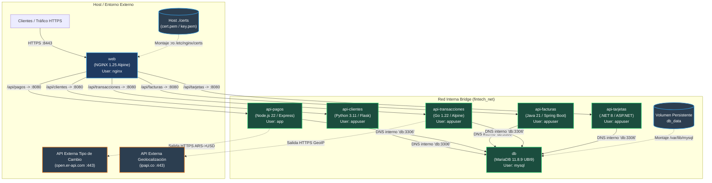

# 🚀 FinTech Nova — Plataforma de Microservicios Distribuidos

<div align="center">


**Trabajo Práctico DevOps — Grupo 6**  
*Plataforma bancaria contenerizada con arquitectura de microservicios, aislamiento de red, proxy inverso con TLS y endurecimiento de seguridad (hardening).*

**Integrantes:** Agustin Thomas Gutierrez Ioime • Fabrizio Luis Peveraro • Juan Hernan Orsi Scillia • Ezequiel Martelloto

Enunciados: [Parte 1](./Enunciado-TP-Parte-1.md) | [Parte 2](./Enunciado-TP-Parte-2.md) • Documentación: [ERRORES.md](./ERRORES.md) | [SEGURIDAD.md](./SEGURIDAD.md) | [AWS_EC2.md](./AWS_EC2.md)

[Imágenes en Docker Hub](#-6-imágenes-oficiales-en-docker-hub) • [Arquitectura](#️-2-arquitectura-y-topología-de-red) • [Servicios](#-3-catálogo-de-servicios) • [Seguridad](#️-4-decisiones-de-diseño-y-hardening-de-seguridad) • [Despliegue y Pruebas](#-5-guía-de-despliegue-y-testeo)

</div>

---

## 📌 1. Introducción a la Solución

**FinTech Nova** es una plataforma orientada a servicios financieros diseñada para operar bajo altos estándares de disponibilidad, seguridad y resiliencia.

Este repositorio implementa la infraestructura completa de la plataforma mediante:
1. Un **servidor centralizado de persistencia relacional** (`MariaDB 11.8.9`) con aprovisionamiento automatizado y particionamiento lógico de esquemas.
2. **Cinco microservicios de dominio** contenerizados bajo **Multistage Builds** y usuarios no privilegiados:
   - **`api-clientes`** (Python 3.11 / Flask)
   - **`api-pagos`** (Node.js 22 / Express sobre Alpine)
   - **`api-facturas`** (Java 21 / Spring Boot con Eclipse Temurin JRE Alpine)
   - **`api-transacciones`** (Go 1.22 compilado estáticamente sobre Alpine 3.19)
   - **`api-tarjetas`** (.NET 8 / ASP.NET Core)
3. Un **Frontend + Proxy Inverso** (**`web`** con NGINX `1.25-alpine`) que constituye el único punto de entrada desde el exterior a través de **HTTPS en el puerto `8443`**, utilizando certificados autofirmados generados en *runtime* y montados como solo lectura (`:ro`).
4. Una red interna aislada (`fintech_net`) que previene la exposición directa de las APIs y la base de datos hacia el host, restringiendo la comunicación a resolución DNS interna.

---

## 🏗️ 2. Arquitectura y Topología de Red

El diseño de red sigue el principio de **menor exposición**: ningún contenedor de base de datos ni de API de lógica de negocio mapea puertos al host. Todo el tráfico ingresa cifrado por el servicio `web` (`8443:8443`).



---

## 📦 3. Catálogo de Servicios

| Servicio | Lenguaje / Base (Builder → Runtime) | Puerto Interno | Mapeo al Host | Usuario Runtime | Límites (CPU / RAM) |
|---|---|---|---|---|---|
| **`db`** | `mariadb:11.8.9-ubi9` | `3306` | ❌ *Ninguno* | `mysql` | 0.50 CPU / 512 MB |
| **`api-clientes`** | `python:3.11-slim` → `python:3.11-slim` | `8080` | ❌ *Ninguno* | `appuser` | 0.30 CPU / 256 MB |
| **`api-pagos`** | `node:22-alpine3.21` → `alpine:3.21` (nodejs) | `8080` | ❌ *Ninguno* | `app` | 0.30 CPU / 256 MB |
| **`api-facturas`** | `maven:3.9.6-eclipse-temurin-21-alpine` → `eclipse-temurin:21-jre-alpine` | `8080` | ❌ *Ninguno* | `appuser` | 2.00 CPU / 256 MB |
| **`api-transacciones`** | `golang:1.22` → `alpine:3.19` | `8080` | ❌ *Ninguno* | `appuser` | 0.30 CPU / 256 MB |
| **`api-tarjetas`** | `mcr.microsoft.com/dotnet/sdk:8.0` → `aspnet:8.0` | `8080` | ❌ *Ninguno* | `appuser` | 0.30 CPU / 256 MB |
| **`web`** | `node:20-alpine` → `nginx:1.25-alpine` | `8443` (SSL) | ✅ `8443:8443` | `nginx` | 0.30 CPU / 256 MB |

---

## 🛡️ 4. Decisiones de Diseño y Hardening de Seguridad

### A. Compilación Multietapa (*Multistage Build*)
* **`api-clientes`:** Etapa `builder` crea el entorno virtual (`/opt/venv`) e instala dependencias; etapa `runtime` parte de `python:3.11-slim` y solo copia el entorno virtual y el código fuente.
* **`api-pagos`:** Etapa `deps` instala dependencias de producción con `npm ci --omit=dev`; etapa `runtime` parte de `alpine:3.21` con el binario de `nodejs`, copiando únicamente `node_modules` y `src/`. Con `init: true` en Compose para manejo limpio de señales PID 1.
* **`api-facturas`:** Etapa `builder` descarga dependencias con Maven y empaqueta el `.jar`; etapa `runtime` utiliza exclusivamente el JRE (`eclipse-temurin:21-jre-alpine`), sin JDK ni Maven en producción, y optimiza el arranque de la JVM mediante `JAVA_TOOL_OPTIONS="-XX:TieredStopAtLevel=1 -Dspring.main.lazy-initialization=true -Dspring.jmx.enabled=false"`.
* **`api-transacciones`:** Etapa `builder` compila un binario 100% estático (`CGO_ENABLED=0 GOOS=linux`); etapa `runtime` parte de `alpine:3.19` (~5 MB) copiando únicamente el ejecutable y `ca-certificates`.
* **`api-tarjetas`:** Etapa `builder` ejecuta `dotnet publish -c Release`; etapa `final` utiliza `mcr.microsoft.com/dotnet/aspnet:8.0` sin el SDK de .NET.
* **`web`:** Etapa `builder` construye los estáticos web con Node 20 (`npm run build`); etapa `runtime` sirve el bundle compilado desde `nginx:1.25-alpine`.
* **Beneficio:** Reducción drástica de la superficie de ataque y del tamaño de las imágenes al eliminar compiladores, gestores de paquetes y SDKs del entorno de ejecución.

### B. Ejecución No Privilegiada (*Non-Root User*)
* Todos los contenedores ejecutan sus procesos principales bajo usuarios de sistema sin privilegios (`appuser`, `app`, `nginx`, `mysql`).
* El contenedor `web` escucha en el puerto no privilegiado `8443` con `USER nginx`, creando previamente `/var/run/nginx.pid` y ajustando permisos sobre `/var/cache/nginx`, `/var/run/nginx.pid`, `/var/log/nginx` y `/etc/nginx/conf.d`, evitando el uso de `root` o capacidades adicionales del kernel (`CAP_NET_BIND_SERVICE`).

### C. TLS en Runtime y Red Aislada
* **Certificados fuera de la imagen:** El par `cert.pem` / `key.pem` nunca se empaqueta en la imagen de Docker ni se sube al repositorio. Se genera en *runtime* en el host (`./certs`) y se inyecta mediante un bind mount de solo lectura (`./certs:/etc/nginx/certs:ro`).
* **Único punto de entrada:** Solo `web` publica el puerto `8443` al host. El puerto `80` permanece cerrado y las APIs/DB solo son alcanzables dentro de la red bridge `fintech_net`.

### D. Aislamiento Lógico de Bases de Datos
* Una única instancia de MariaDB aloja 5 esquemas independientes (`db_clientes`, `db_transacciones`, `db_pagos`, `db_facturas`, `db_tarjetas`).
* El script inicial `00-databases.sh` crea los esquemas y otorga permisos al usuario de aplicación (`MYSQL_USER`), evitando que los microservicios se conecten con la cuenta administrativa `root` y aislando lógicamente las tablas por dominio (`DB_NAME`).

### E. Gestión de Secretos, Healthchecks y Límites de Cómputo
* **Cero Secretos Hardcodeados:** Configuración inyectada mediante directivas `env_file` (`<servicio>/.env`), excluidas tanto en `.gitignore` como en `.dockerignore`.
* **Orquestación de Arranque (`healthcheck`):** Los 5 microservicios esperan a que MariaDB esté completamente inicializada (`service_healthy`), y `web` espera al healthcheck activo de `api-facturas` antes de recibir tráfico.
* **Protección contra DoS / Saturation:** Límites de recursos (`deploy.resources.limits`) de CPU y RAM en todos los servicios (asignando `2.00 vCPU` a `api-facturas` para absorber la ráfaga de arranque de la JVM y `0.30 vCPU` al resto de las APIs, con un tope de `2048 MB` de RAM total dimensionado para una instancia AWS EC2 `t3.medium`) junto con política `restart: always`.

### F. Resiliencia ante APIs externas
* **`api-pagos` (tipo de cambio):** consulta una API pública (`open.er-api.com`) para calcular `monto_usd` a partir del monto en ARS. La llamada tiene un *timeout* de 5 segundos; si la API no responde, devuelve un error HTTP o no incluye la tasa USD, `convertirArsAUsd()` registra el error en el log y retorna `null`, y el pago se guarda igual con `monto_usd = null`. El ABM no se interrumpe: solo falta el dato enriquecido.
* **`api-transacciones` (geolocalización):** consulta `ipapi.co` para obtener el país de la IP de origen. Ante un error (por ejemplo `RateLimited`, observado en AWS), `obtenerPais()` lo registra en el log y devuelve una cadena vacía; la transacción se guarda con el campo `pais` vacío (ver [ERRORES.md](./ERRORES.md), error #23).

---

## 🚀 5. Guía de Despliegue y Testeo

### A. Despliegue Automatizado en AWS EC2 (`deploy.sh`)

El script [`deploy.sh`](./deploy.sh) en la raíz del repositorio automatiza de punta a punta el aprovisionamiento de una instancia **AWS EC2 `t3.medium` (Amazon Linux 2023)** desde cero (instalación de Docker Engine y plugin Compose v2, transferencia segura de `docker-compose.yml` y archivos `.env` vía `scp`, generación del certificado TLS autofirmado en *runtime*, `docker compose pull` + `up -d` y pruebas de validación con `curl -k`):

```bash
# Completo (incluyendo build local y push a Docker Hub):
bash deploy.sh <EC2_IP> "<RUTA_CLAVE_PEM>"

# Omitiendo build/push cuando las imágenes ya están publicadas en Docker Hub:
bash deploy.sh <EC2_IP> "<RUTA_CLAVE_PEM>" --skip-build
```

### B. Despliegue Manual / Local

#### Prerrequisitos
* [Docker Engine](https://docs.docker.com/engine/install/) versión 24.0 o superior.
* [Docker Compose](https://docs.docker.com/compose/) v2.x+.
* `openssl` y `curl` disponibles en la terminal.

#### Pasos para levantar la plataforma

1. **Ubicarse en el directorio de contenedores:**
   ```bash
   cd aplicaciones-contenedores
   ```

2. **Configurar las variables de entorno (`.env`):**
   Copiar los archivos de ejemplo de cada servicio y definir sus credenciales:
   ```bash
   cp db/env.example db/.env
   cp api-clientes/env.example api-clientes/.env
   cp api-pagos/env.example api-pagos/.env
   cp api-facturas/env.example api-facturas/.env
   cp api-transacciones/env.example api-transacciones/.env
   cp api-tarjetas/env.example api-tarjetas/.env
   ```

3. **Generar el certificado TLS autofirmado en `./certs` (Runtime):**
   ```bash
   mkdir -p certs && openssl req -x509 -nodes -days 365 -newkey rsa:2048 \
     -keyout certs/key.pem -out certs/cert.pem -subj "/CN=localhost" && \
     chmod 644 certs/key.pem certs/cert.pem
   ```

4. **Iniciar todos los contenedores y verificar su ejecución:**
   ```bash
   docker compose up -d
   docker compose ps
   ```

### C. Testeo de Servicios a través del Proxy Web (`https://<HOST>:8443`)

Una vez levantados los contenedores, se puede verificar tanto el frontend (`/`) como el ruteo inverso hacia las 5 APIs (`/api/*`) utilizando `curl -k` (para aceptar el certificado autofirmado):

* **Contra la instancia AWS EC2 (o `localhost`):**
  ```bash
  for ep in / /api/clientes /api/pagos /api/facturas /api/transacciones /api/tarjetas; do
    echo -e "\n=== Probando $ep ==="
    curl -k -i "https://<EC2_IP>:8443$ep"
  done
  ```

* **En PowerShell (Windows):**
  ```powershell
  "/", "/api/clientes", "/api/pagos", "/api/facturas", "/api/transacciones", "/api/tarjetas" | ForEach-Object { Write-Host "`n=== Probando $_ ===" -ForegroundColor Cyan; curl.exe -k -i "https://<EC2_IP>:8443$_" }
  ```

* **Desde el navegador web:**
  Acceder a `https://<EC2_IP>:8443` y aceptar la advertencia de certificado autofirmado para utilizar la interfaz gráfica de **FinTech Nova**.

### D. Evidencia de Funcionamiento en AWS EC2

#### 1. Ejecución de `deploy.sh` y estado de los contenedores (`docker compose ps`)
[captura de pantalla de la terminal ejecutando bash deploy.sh <EC2_IP> "<RUTA_CLAVE_PEM>" --skip-build mostrando los 7 contenedores Up y los 6 chequeos HTTP 200]

#### 2. Pruebas `curl -k` contra los 5 endpoints a través de la IP pública de la EC2 (`:8443`)
[captura de pantalla de la terminal ejecutando curl -k contra https://<EC2_IP>:8443/api/clientes, /api/pagos, /api/facturas, /api/transacciones y /api/tarjetas mostrando las respuestas JSON]

#### 3. Aplicación Web y ABM funcionando en AWS EC2 (`https://<EC2_IP>:8443`)
[captura de pantalla del navegador en https://<EC2_IP>:8443 mostrando la portada con los apellidos/nombres de los 4 integrantes del grupo y el ABM de Clientes]

[captura de pantalla del navegador en https://<EC2_IP>:8443 mostrando el ABM de Pagos (con monto_usd calculado por la API externa), Facturas, Transacciones y Tarjetas]

---

## 🐳 6. Imágenes Oficiales en Docker Hub

Las imágenes consumidas por `docker-compose.yml` están publicadas en Docker Hub bajo versionado semántico:

* 🗄️ **Base de Datos (`db`):** [`devopsgrupo6/db:1.0.0`](https://hub.docker.com/r/devopsgrupo6/db)
* 👤 **API Clientes (`api-clientes`):** [`devopsgrupo6/api-clientes:1.0.0`](https://hub.docker.com/r/devopsgrupo6/api-clientes)
* 💸 **API Pagos (`api-pagos`):** [`devopsgrupo6/api-pagos:1.0.0`](https://hub.docker.com/r/devopsgrupo6/api-pagos)
* 🧾 **API Facturas (`api-facturas`):** [`devopsgrupo6/api-facturas:1.0.0`](https://hub.docker.com/r/devopsgrupo6/api-facturas)
* 💳 **API Transacciones (`api-transacciones`):** [`devopsgrupo6/api-transacciones:1.0.0`](https://hub.docker.com/r/devopsgrupo6/api-transacciones)
* 🪪 **API Tarjetas (`api-tarjetas`):** [`devopsgrupo6/api-tarjetas:1.0.0`](https://hub.docker.com/r/devopsgrupo6/api-tarjetas)
* 🌐 **Frontend + Proxy (`web`):** [`devopsgrupo6/web:1.0.0`](https://hub.docker.com/r/devopsgrupo6/web)